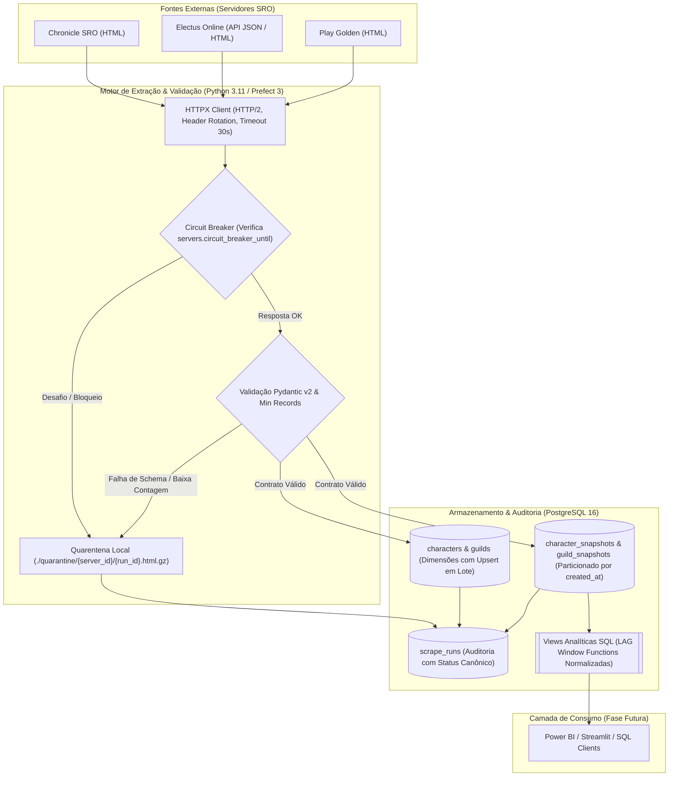

# SRO Ranking Scraper Pipeline (v1.0)

*   **Author:** richardman13
*   **Status:** Ready for Commit
*   **Date:** 2026-11-18

--------------------------------------------------------------------------------

## Overview

O **SRO Ranking Scraper** é um pipeline de dados containerizado projetado para transformar dados efêmeros de rankings públicos de servidores privados de Silkroad Online (**Chronicle SRO**, **Electus Online** e **Play Golden**) em séries temporais imutáveis e auditáveis no PostgreSQL 16.

O sistema opera sob cadência regular de 12 horas combinada com um gatilho extraordinário pós-Fortress War (FW) desacoplado por servidor. Através de um modelo append-only com auditoria temporal (`created_at`, `updated_at`) e views analíticas orientadas a window functions (`LAG()`), o projeto viabiliza a medição de atividade real de jogadores, retenção semanal, dinâmicas de poder entre guildas e balanceamento de raças (Chinese vs European), estabelecendo bases analíticas sólidas para consumo posterior em ferramentas como Power BI ou Streamlit.

## The Problem

Os rankings públicos de servidores privados de Silkroad Online apresentam desafios críticos para análise histórica:
1. **Natureza Efêmera e Perda de Histórico:** Sites de servidores privados mantêm apenas o estado presente dos rankings. Mudanças diárias de nível, pontuação de itens (Item Points) e turnover de membros de guilda são sobrescritas continuamente, tornando impossível medir a evasão de jogadores ou a curva de atividade ao longo do ciclo de vida do servidor.
2. **Volatilidade Operacional e Schema Drift:** Servidores privados frequentemente alteram layouts HTML, URLs de paginação ou ativam proteções de tráfego (Cloudflare Turnstile) sem aviso prévio. Crawlers frágeis quebram silenciosamente ou gravam dados parciais corrompidos no banco.
3. **Distorção por Bots e Doações:** Servidores de Silkroad são fortemente impactados por automação desassistida (bots de grind 24/7) e compra direta de equipamentos via doações financeiras. Rankings estáticos agregam esses perfis sem distinguir esforço legítimo de doação ou automação contínua.

A solução consiste em desacoplar a ingestão da análise, extraindo dados tabulares via HTTPX com isolamento estrito de falhas por alvo, validação de schema duplo (Pydantic v2 + limiar mínimo de registros), quarentena automática de payloads anômalos e persistência append-only com views SQL normalizadas por hora.

## Goals

*   **G1 (Extração Resiliente e Isolada):** Coletar dados de ranking (Personagens e Guildas) dos 3 servidores alvo (Chronicle, Electus, Play Golden) a cada 12h e pós-FW, garantindo que falhas em um alvo não afetem a execução dos demais.
*   **G2 (Integridade Append-Only e Auditoria):** Registrar 100% das execuções na tabela `scrape_runs` e persistir snapshots de forma estritamente aditiva com colunas de auditoria temporal (`created_at`, `updated_at`).
*   **G3 (Prevenção de Schema Drift e Quarentena):** Validar contratos via Pydantic v2 e aplicar limiar mínimo de registros (`min_records_threshold`). Payloads que falharem na validação devem ser desviados para quarentena local compactada (`./quarantine/{server_id}/{run_id}.html.gz`) sem poluir o banco.
*   **G4 (Geração de Séries Temporais Analíticas):** Disponibilizar Views SQL nativas no PostgreSQL com window functions para cálculo de taxas horárias de atividade (`rate_per_hour`), classificação heurística de bots vs doadores, dominância no Top 100 e retenção semanal.

## Non-Goals

*   **NG1 (Deep Scraping de Perfis):** Rastrear inventários detalhados, grau de refino (+plus) de itens ou árvores de skills por personagem na v1.0.
*   **NG2 (Telemetria em Tempo Real):** Inspecionar chat global, logs de alquimia ou spawn/morte de Uniques ao vivo.
*   **NG3 (Bypasses Pagos ou Infraestrutura Pesada):** Utilizar serviços comerciais de resolução de CAPTCHA, pools de proxies rotativos pagos ou orquestradores com JVM (Spark/Airflow).
*   **NG4 (Alertas Externos e Interfaces Gráficas):** Desenvolver bots para Discord/Telegram ou dashboards no Streamlit/Power BI nesta primeira versão.
*   **NG5 (Rastreamento Heurístico de Renames na v1.0):** Rastreamento de trocas de nome de personagens (*Character Name Change Scrolls*) está fora do escopo da v1.0; a identidade do personagem é estritamente vinculada a `(server_id, char_name)`. Uma troca de nome é tratada como churn natural.

## Open Questions

*   **Q1:** A rota de ranking do Electus Online permite consumo direto de endpoint JSON ou requer bypass de cabeçalhos/cookies específicos de sessão? *(Será investigado na fase de mapeamento técnico do scraper).*
*   **Q2:** A Fortress War ocorre em horários e dias distintos entre os 3 servidores? *(Configurado dinamicamente por servidor na tabela `servers` através dos campos `fw_day_of_week` e `fw_end_time_utc`).*

## Critical User Journeys (CUJs)

### CUJ 1: Ingestão Agendada Periódica (Ciclo de 12 Horas)
*   **Given:** Containers do PostgreSQL 16 e Prefect 3 em execução e servidores alvo acessíveis.
*   **When:** O agendador Cron do Prefect dispara o flow principal às 00:00 ou 12:00 UTC.
*   **Then:** O worker extrai os rankings de cada alvo via HTTPX, valida contra os modelos Pydantic v2, grava a auditoria em `scrape_runs`, executa pré-resolução de dimensões e insere os registros append-only nas partições de `character_snapshots` e `guild_snapshots`.

### CUJ 2: Tratamento de Schema Drift ou Bloqueio Anti-Bot
*   **Given:** Um dos servidores (ex: Electus) altera sua estrutura de classes CSS ou apresenta tela de desafio Cloudflare Turnstile (HTTP 403 / cf-challenge).
*   **When:** O scraper do alvo específico detecta erro de parsing, registros abaixo do limiar ou assinatura do Turnstile.
*   **Then:** O Circuit Breaker abre para aquele alvo gravando `circuit_breaker_until = NOW() + INTERVAL '6 hours'` na tabela `servers`, o HTML bruto da resposta é compactado e armazenado em `./quarantine/{server_id}/{run_id}.html.gz`, o status `SCHEMA_DRIFT` ou `BLOCKED_CHALLENGE` é registrado em `scrape_runs`, e o pipeline prossegue com a coleta dos outros alvos sem interrupção.

### CUJ 3: Consulta Analítica de Séries Temporais
*   **Given:** Ao menos 3 dias de coletas executadas com sucesso no banco.
*   **When:** Um analista ou ferramenta de BI executa `SELECT * FROM v_character_activity_deltas` ou `v_bot_vs_donor_classification`.
*   **Then:** A query retorna deltas normalizados por hora (`rate_per_hour`) e segmentação comportamental sem necessidade de pré-processamento manual em Python.

--------------------------------------------------------------------------------

## Technical Plan (Architecture)

### 1. High-Level Architecture & Data Flow

O pipeline é orquestrado de forma totalmente desacoplada através do **Prefect 3**, executando em containers Docker sobre rede isolada. O fluxo de dados opera em quatro etapas síncronas por servidor: **Extração**, **Validação & Quarentena**, **Persistência Append-Only** e **Disponibilização Analítica**.



### 2. Topologia de Infraestrutura (Docker Compose)

O ambiente operacional é composto por 3 serviços orquestrados via `docker-compose.yml`:
1. **`postgres`:** PostgreSQL 16 com volume persistente montado em disco (`postgres_data`). Configurado com parâmetros de memória ajustados para consultas analíticas (`shared_buffers = 512MB`, `work_mem = 64MB`).
2. **`prefect-server`:** Backend self-hosted do Prefect 3 expondo a UI e API local (`localhost:4200`). Utiliza um banco SQLite dedicado montado em volume ou schema isolado no Postgres.
3. **`scraper-worker`:** Container Python 3.11 executando o Prefect Runner / Worker. Conectado ao `prefect-server` via `PREFECT_API_URL=http://prefect-server:4200/api`. Possui acesso à rede externa para saída HTTP aos servidores de jogo e rede interna para comunicação com `postgres`. Monta volume compartilhado `./quarantine:/app/quarantine` para gravação de diagnósticos.

### 3. Motor de Extração HTTP-First & Circuit Breaker Persistente

* **Sessão HTTPX Otimizada:** Cada execução utiliza cliente assíncrono `httpx.AsyncClient` com suporte a `http2=True`, limites estritos de conexões (`httpx.Limits(max_keepalive_connections=5, max_connections=10)`), timeouts específicos (Connect: 10s, Read: 30s) e rotação determinística de cabeçalhos legítimos (`User-Agent`, `Accept-Language`, `Sec-Ch-Ua`).
* **Design Pattern Strategy por Alvo:**
  * `BaseRankingScraper`: Classe base abstrata que encapsula retries exponenciais, medição de tempo, logging estruturado (`structlog`), persistência do circuit breaker e registro na tabela `scrape_runs`.
  * `ChronicleScraper`: Implementa parsing tabular HTML via `lxml` com seletores CSS fixados em `table.ranking-table tbody tr`.
  * `ElectusScraper`: Prioriza inspeção de endpoints JSON de paginação interna (`/api/ranking/...`). Emprega decodificação rápida via `orjson`.
  * `PlayGoldenScraper`: Implementa parsing HTML padrão para templates clássicos de vSRO.
* **Lógica do Circuit Breaker Persistente:**
  * **Verificação Pré-Execução:** Antes de iniciar qualquer requisição, o worker consulta `servers.circuit_breaker_until`. Se `CURRENT_TIMESTAMP < circuit_breaker_until`, a execução para aquele alvo é abortada imediatamente sem envio de tráfego de rede, registrando log com o tempo restante de cooldown.
  * **Detecção de Bloqueio:** O crawler inspeciona status HTTP (`403`, `429`) e assinaturas textuais no corpo/headers (ex: `<div id="turnstile-wrapper">`, tokens `cf-chl-bypass`, `cf-mitigated: challenge`).
  * **Ativação:** Ao detectar desafio interativo Turnstile ou 403/429, o scraper executa:
    ```sql
    UPDATE servers SET circuit_breaker_until = CURRENT_TIMESTAMP + INTERVAL '6 hours' WHERE id = :server_id;
    ```
    Gravando status `BLOCKED_CHALLENGE` em `scrape_runs` e finalizando a task sem retentativas agressivas.
* **Orquestração de Disparos Extraordinários pós-Fortress War (FW):**
  * Disparos pós-FW utilizam deployments independentes no Prefect 3 por servidor:
    * `post_fw_flow.to_deployment(name="post-fw-chronicle", cron="30 22 * * 0")`
    * `post_fw_flow.to_deployment(name="post-fw-electus", cron="...")`
  * Os horários são parametrizados a partir das colunas `fw_day_of_week` e `fw_end_time_utc` da tabela `servers`, disparando 30 minutos após o término da fortaleza de cada servidor.

### 4. Validação de Contratos & Sistema de Quarentena

A validação separa campos padronizados essenciais de atributos dinâmicos específicos de cada servidor (armazenados em `extra_metrics` JSONB), cobrindo Rankings de Jogadores, Jobs e Guildas:

```python
from typing import Any, Literal, Optional
from pydantic import BaseModel, ConfigDict, Field, field_validator


class RawPlayerRankingItem(BaseModel):
    model_config = ConfigDict(strict=False, str_strip_whitespace=True)

    # --- Campos Core (Obrigatórios - quebram o lote se falharem) ---
    rank: int = Field(ge=1)
    char_name: str = Field(min_length=1, max_length=64)
    level: int = Field(ge=1, le=140)

    # --- Campos Padronizados (Comuns entre os servidores) ---
    guild_name: Optional[str] = None
    race: Optional[Literal["CH", "EU"]] = None
    item_points: Optional[float] = Field(default=None, ge=0)
    strength: Optional[int] = Field(default=None, ge=0)
    intellect: Optional[int] = Field(default=None, ge=0)
    title: Optional[str] = None

    # --- Ecossistema de Job & Honor ---
    job_type: Optional[Literal["TRADER", "THIEF", "HUNTER"]] = None
    job_level: Optional[int] = Field(default=None, ge=0)
    job_points: Optional[int] = Field(default=None, ge=0)
    job_exp: Optional[int] = Field(default=None, ge=0)
    honor_points: Optional[int] = Field(default=None, ge=0)

    # --- Atributos Exclusivos por Servidor (Persistidos em JSONB) ---
    # Ex: gold, sox_parts, last_logout, elo_points, unique_points, hours_played, pvp_kd
    extra_metrics: dict[str, Any] = Field(default_factory=dict)

    @field_validator("guild_name", "title", mode="before")
    @classmethod
    def normalize_empty_strings(cls, v: Any) -> Optional[str]:
        if v is None:
            return None
        cleaned = str(v).strip()
        if cleaned in {"", "-", "None", "No Name", "XXXX", "N/A"}:
            return None
        return cleaned

    @field_validator("race", mode="before")
    @classmethod
    def normalize_race(cls, v: Any) -> Optional[str]:
        if not v:
            return None
        cleaned = str(v).strip().upper()
        if any(token in cleaned for token in ("CH", "CHINA", "CHINESE")):
            return "CH"
        if any(token in cleaned for token in ("EU", "EUROPE", "EUROPEAN")):
            return "EU"
        return None

    @field_validator("job_type", mode="before")
    @classmethod
    def normalize_job_type(cls, v: Any) -> Optional[str]:
        if not v:
            return None
        val = str(v).strip().upper()
        mapping = {
            "TRADER": "TRADER",
            "MERCADOR": "TRADER",
            "THIEF": "THIEF",
            "LADRÃO": "THIEF",
            "HUNTER": "HUNTER",
            "CAÇADOR": "HUNTER",
        }
        return mapping.get(val)

    @field_validator(
        "strength",
        "intellect",
        "job_level",
        "job_points",
        "job_exp",
        "honor_points",
        mode="before",
    )
    @classmethod
    def clean_int_numbers(cls, v: Any) -> Optional[int]:
        if v is None or v == "":
            return None
        if isinstance(v, int):
            return v
        digits = "".join(filter(str.isdigit, str(v)))
        return int(digits) if digits else None

    @field_validator("item_points", mode="before")
    @classmethod
    def clean_float_numbers(cls, v: Any) -> Optional[float]:
        if v is None or v == "":
            return None
        if isinstance(v, (int, float)):
            return float(v)
        cleaned = str(v).replace(",", ".").strip()
        try:
            return float(cleaned)
        except ValueError:
            return None


class RawJobRankingItem(BaseModel):
    model_config = ConfigDict(strict=False, str_strip_whitespace=True)

    rank: int = Field(ge=1)
    char_name: str = Field(min_length=1, max_length=64)
    job_type: Literal["TRADER", "THIEF", "HUNTER"]
    job_level: int = Field(ge=1, le=140)
    job_exp: Optional[int] = Field(default=None, ge=0)
    guild_name: Optional[str] = None
    extra_metrics: dict[str, Any] = Field(default_factory=dict)

    @field_validator("job_type", mode="before")
    @classmethod
    def normalize_job_type(cls, v: Any) -> Optional[str]:
        if not v:
            return None
        val = str(v).strip().upper()
        mapping = {
            "TRADER": "TRADER",
            "MERCADOR": "TRADER",
            "THIEF": "THIEF",
            "LADRÃO": "THIEF",
            "HUNTER": "HUNTER",
            "CAÇADOR": "HUNTER",
        }
        return mapping.get(val)

    @field_validator("job_level", "job_exp", mode="before")
    @classmethod
    def clean_int_numbers(cls, v: Any) -> Optional[int]:
        if v is None or v == "":
            return None
        if isinstance(v, int):
            return v
        digits = "".join(filter(str.isdigit, str(v)))
        return int(digits) if digits else None


class RawGuildRankingItem(BaseModel):
    model_config = ConfigDict(strict=False, str_strip_whitespace=True)

    rank: int = Field(ge=1)
    guild_name: str = Field(min_length=1, max_length=64)
    master_name: Optional[str] = None
    members_count: Optional[int] = Field(default=None, ge=0)
    total_item_points: Optional[float] = Field(default=None, ge=0)
    fortress_held: Optional[str] = None
    extra_metrics: dict[str, Any] = Field(default_factory=dict)

    @field_validator("guild_name", "master_name", "fortress_held", mode="before")
    @classmethod
    def normalize_empty_strings(cls, v: Any) -> Optional[str]:
        if v is None:
            return None
        cleaned = str(v).strip()
        if cleaned in {"", "-", "None", "No Name", "XXXX", "N/A"}:
            return None
        return cleaned

    @field_validator("members_count", mode="before")
    @classmethod
    def clean_int_numbers(cls, v: Any) -> Optional[int]:
        if v is None or v == "":
            return None
        if isinstance(v, int):
            return v
        digits = "".join(filter(str.isdigit, str(v)))
        return int(digits) if digits else None

    @field_validator("total_item_points", mode="before")
    @classmethod
    def clean_float_numbers(cls, v: Any) -> Optional[float]:
        if v is None or v == "":
            return None
        if isinstance(v, (int, float)):
            return float(v)
        cleaned = str(v).replace(",", ".").strip()
        try:
            return float(cleaned)
        except ValueError:
            return None
```

* **Critério de Detecção de Drift & Guard de Pódio:**
  * **Top-Rank Integrity Guard:** Se os registros das posições 1, 2 ou 3 falharem na validação ou no parsing, o lote é rejeitado imediatamente, mesmo que a taxa global de erro esteja abaixo de 5%.
  * **Taxa de Erro Global:** Rejeição do lote se `validation_errors / total_records > 0.05` ou se campos core (`rank`, `char_name`, `level`) forem corrompidos.
  * **Contagem Mínima (`min_records_threshold`):** Chronicle (min 100), Electus (min 100), Play Golden (min 50).
* **Mecanismo de Quarentena (Dead-Letter):**
  * Payloads reprovados são compactados em gzip e gravados em `./quarantine/{server_id}/{run_id}.html.gz`.
  * A tabela `scrape_runs` armazena apenas o hash `sha256`, tamanho em bytes e o caminho de referência.
  * **Política de Retenção de Quarentena:** Arquivos em `./quarantine` com mais de 30 dias de criação são expurgados automaticamente por uma task de manutenção do Prefect para prevenir esgotamento de disco.

### 5. Modelagem de Dados Relacional & Temporal (PostgreSQL 16)

O banco adota o princípio **append-only** e separação estrita de dimensões e fatos:

```sql
-- Habilitação da extensão de UUID
CREATE EXTENSION IF NOT EXISTS "pgcrypto";

-- Tabela de Configuração dos Alvos
CREATE TABLE servers (
    id VARCHAR(32) PRIMARY KEY, -- 'chronicle', 'electus', 'play_golden'
    display_name VARCHAR(64) NOT NULL,
    base_url VARCHAR(255) NOT NULL,
    current_season VARCHAR(32) NOT NULL DEFAULT 'v1',
    is_active BOOLEAN NOT NULL DEFAULT TRUE,
    fw_day_of_week SMALLINT NOT NULL DEFAULT 0, -- 0 = Domingo
    fw_end_time_utc TIME NOT NULL DEFAULT '22:00:00',
    min_records_expected INTEGER NOT NULL DEFAULT 50,
    circuit_breaker_until TIMESTAMPTZ DEFAULT NULL,
    created_at TIMESTAMPTZ NOT NULL DEFAULT CURRENT_TIMESTAMP,
    updated_at TIMESTAMPTZ NOT NULL DEFAULT CURRENT_TIMESTAMP
);

-- Tabela de Auditoria com Status Canônico
CREATE TABLE scrape_runs (
    id UUID PRIMARY KEY DEFAULT gen_random_uuid(),
    server_id VARCHAR(32) NOT NULL REFERENCES servers(id),
    ranking_category VARCHAR(32) NOT NULL DEFAULT 'all',
    trigger_type VARCHAR(16) NOT NULL, -- 'scheduled_12h', 'post_fw_extra', 'manual'
    status VARCHAR(24) NOT NULL CHECK (status IN (
        'SUCCESS', 'PARTIAL_SUCCESS', 'SCHEMA_DRIFT', 
        'LOW_COUNT_QUARANTINE', 'BLOCKED_CHALLENGE', 
        'TARGET_MAINTENANCE', 'HTTP_ERROR'
    )),
    records_extracted INTEGER NOT NULL DEFAULT 0,
    records_persisted INTEGER NOT NULL DEFAULT 0,
    validation_errors_count INTEGER NOT NULL DEFAULT 0,
    execution_time_ms INTEGER NOT NULL,
    http_status_code INTEGER,
    quarantine_file_path VARCHAR(255),
    error_details JSONB,
    created_at TIMESTAMPTZ NOT NULL DEFAULT CURRENT_TIMESTAMP,
    updated_at TIMESTAMPTZ NOT NULL DEFAULT CURRENT_TIMESTAMP
);

-- Dimensões (Identidade por server_id)
CREATE TABLE characters (
    id UUID PRIMARY KEY DEFAULT gen_random_uuid(),
    server_id VARCHAR(32) NOT NULL REFERENCES servers(id),
    char_name VARCHAR(64) NOT NULL,
    race VARCHAR(4) CHECK (race IN ('CH', 'EU', 'UNK')),
    first_seen_at TIMESTAMPTZ NOT NULL,
    last_seen_at TIMESTAMPTZ NOT NULL,
    CONSTRAINT uq_char_per_server UNIQUE (server_id, char_name)
);

CREATE TABLE guilds (
    id UUID PRIMARY KEY DEFAULT gen_random_uuid(),
    server_id VARCHAR(32) NOT NULL REFERENCES servers(id),
    guild_name VARCHAR(64) NOT NULL,
    master_char_name VARCHAR(64),
    first_seen_at TIMESTAMPTZ NOT NULL,
    last_seen_at TIMESTAMPTZ NOT NULL,
    is_active BOOLEAN NOT NULL DEFAULT TRUE,
    CONSTRAINT uq_guild_per_server UNIQUE (server_id, guild_name)
);

-- Fatos Temporais (Append-Only com Particionamento por created_at)
CREATE TABLE character_snapshots (
    id BIGINT GENERATED ALWAYS AS IDENTITY,
    scrape_run_id UUID NOT NULL REFERENCES scrape_runs(id),
    server_id VARCHAR(32) NOT NULL REFERENCES servers(id),
    character_id UUID NOT NULL REFERENCES characters(id),
    guild_id UUID REFERENCES guilds(id),
    rank_position INTEGER NOT NULL,
    level INTEGER NOT NULL,
    race VARCHAR(4),
    item_points NUMERIC(10, 2) NOT NULL DEFAULT 0.0,
    strength INTEGER,
    intellect INTEGER,
    title VARCHAR(64),
    job_type VARCHAR(16),
    job_level INTEGER,
    job_points INTEGER,
    job_exp BIGINT,
    honor_points INTEGER,
    extra_metrics JSONB NOT NULL DEFAULT '{}'::jsonb,
    created_at TIMESTAMPTZ NOT NULL DEFAULT CURRENT_TIMESTAMP,
    updated_at TIMESTAMPTZ NOT NULL DEFAULT CURRENT_TIMESTAMP,
    CONSTRAINT pk_character_snapshots PRIMARY KEY (id, created_at),
    CONSTRAINT uq_char_snapshot_run UNIQUE (scrape_run_id, character_id, created_at)
) PARTITION BY RANGE (created_at);

CREATE TABLE guild_snapshots (
    id BIGINT GENERATED ALWAYS AS IDENTITY,
    scrape_run_id UUID NOT NULL REFERENCES scrape_runs(id),
    server_id VARCHAR(32) NOT NULL REFERENCES servers(id),
    guild_id UUID NOT NULL REFERENCES guilds(id),
    rank_position INTEGER NOT NULL,
    members_count INTEGER NOT NULL DEFAULT 0,
    total_item_points NUMERIC(12, 2) NOT NULL DEFAULT 0.0,
    fortress_held VARCHAR(32),
    extra_metrics JSONB NOT NULL DEFAULT '{}'::jsonb,
    created_at TIMESTAMPTZ NOT NULL DEFAULT CURRENT_TIMESTAMP,
    updated_at TIMESTAMPTZ NOT NULL DEFAULT CURRENT_TIMESTAMP,
    CONSTRAINT pk_guild_snapshots PRIMARY KEY (id, created_at)
) PARTITION BY RANGE (created_at);

-- Partições Iniciais por Mês
CREATE TABLE character_snapshots_2026_11 PARTITION OF character_snapshots
    FOR VALUES FROM ('2026-11-01 00:00:00+00') TO ('2026-12-01 00:00:00+00');

CREATE TABLE guild_snapshots_2026_11 PARTITION OF guild_snapshots
    FOR VALUES FROM ('2026-11-01 00:00:00+00') TO ('2026-12-01 00:00:00+00');

-- Índices Especializados
CREATE INDEX idx_char_snapshots_lookup 
    ON character_snapshots (server_id, character_id, created_at DESC);
CREATE INDEX idx_char_snapshots_rank 
    ON character_snapshots (server_id, created_at, rank_position);
CREATE INDEX idx_char_snapshots_brin_time 
    ON character_snapshots USING BRIN (created_at);
CREATE INDEX idx_char_snapshots_extra_metrics 
    ON character_snapshots USING GIN (extra_metrics);
```

* **Rotina de Pré-Resolução de Dimensões em Lote:**
  Antes da inserção em massa nas tabelas de fatos, o worker resolve as chaves estrangeiras executando upsert em lote:
  ```sql
  INSERT INTO characters (server_id, char_name, race, first_seen_at, last_seen_at)
  VALUES (:server_id, :char_name, :race, :now, :now)
  ON CONFLICT (server_id, char_name) 
  DO UPDATE SET last_seen_at = EXCLUDED.last_seen_at
  RETURNING id, char_name;
  ```
  O retorno alimenta um mapa em memória (`char_name -> character_id`) que substitui as strings pelos UUIDs respectivos, viabilizando a persistência dos snapshots via `bulk_insert_mappings` ou `COPY` em menos de 500ms.

### 6. Camada Analítica SQL (Views Nativas)

```sql
-- View 1: Taxa de Atividade Real e Variação com LAG() Normalizado
CREATE OR REPLACE VIEW v_character_activity_deltas AS
WITH sequenced_snapshots AS (
    SELECT 
        cs.server_id,
        cs.character_id,
        c.char_name,
        COALESCE(cs.race, c.race) AS race,
        cs.rank_position,
        cs.level,
        cs.item_points,
        cs.job_type,
        cs.job_level,
        cs.job_points,
        cs.job_exp,
        cs.honor_points,
        cs.created_at,
        LAG(cs.level) OVER w AS prev_level,
        LAG(cs.item_points) OVER w AS prev_item_points,
        LAG(cs.job_points) OVER w AS prev_job_points,
        LAG(cs.job_exp) OVER w AS prev_job_exp,
        LAG(cs.honor_points) OVER w AS prev_honor_points,
        LAG(cs.created_at) OVER w AS prev_created_at,
        LAG(cs.rank_position) OVER w AS prev_rank
    FROM character_snapshots cs
    JOIN characters c ON c.id = cs.character_id
    WINDOW w AS (PARTITION BY cs.server_id, cs.character_id ORDER BY cs.created_at)
)
SELECT 
    server_id,
    character_id,
    char_name,
    race,
    rank_position,
    (prev_rank - rank_position) AS rank_gain,
    level,
    (level - prev_level) AS delta_level,
    (item_points - prev_item_points) AS delta_item_points,
    (job_points - prev_job_points) AS delta_job_points,
    (job_exp - prev_job_exp) AS delta_job_exp,
    (honor_points - prev_honor_points) AS delta_honor_points,
    created_at,
    prev_created_at,
    ROUND(CAST(EXTRACT(EPOCH FROM (created_at - prev_created_at)) / 3600 AS NUMERIC), 2) AS hours_since_last_snapshot,
    CASE 
        WHEN prev_created_at IS NOT NULL AND EXTRACT(EPOCH FROM (created_at - prev_created_at)) > 0 THEN
            ROUND(CAST((item_points - prev_item_points) / (EXTRACT(EPOCH FROM (created_at - prev_created_at)) / 3600) AS NUMERIC), 2)
        ELSE 0 
    END AS item_points_rate_per_hour
FROM sequenced_snapshots
WHERE prev_created_at IS NOT NULL;

-- View 2: Classificação Heurística: Bot 24/7 vs Doador/Whale
CREATE OR REPLACE VIEW v_bot_vs_donor_classification AS
WITH recent_activity AS (
    SELECT 
        server_id,
        character_id,
        char_name,
        race,
        COUNT(*) AS evaluated_intervals,
        SUM(delta_item_points) AS total_item_points_gain,
        MAX(delta_item_points) AS max_single_jump_item_points,
        MIN(hours_since_last_snapshot) AS min_interval_hours,
        COUNT(*) FILTER (WHERE 
            COALESCE(delta_level, 0) > 0 OR 
            COALESCE(delta_job_exp, 0) > 0 OR 
            COALESCE(delta_job_points, 0) > 0 OR 
            COALESCE(delta_honor_points, 0) > 0
        ) AS active_grind_intervals
    FROM v_character_activity_deltas
    WHERE created_at >= CURRENT_TIMESTAMP - INTERVAL '7 days'
    GROUP BY server_id, character_id, char_name, race
    HAVING COUNT(*) >= 6 -- Mínimo de 3 dias de histórico (6 snapshots de 12h)
)
SELECT 
    server_id,
    character_id,
    char_name,
    race,
    evaluated_intervals,
    total_item_points_gain,
    max_single_jump_item_points,
    ROUND(CAST(active_grind_intervals::NUMERIC / evaluated_intervals AS NUMERIC), 2) AS grind_persistence_ratio,
    CASE 
        -- Assinatura de Bot 24/7: Moagem ininterrupta de Job/Level em >= 90% dos intervalos sem pausas
        WHEN (active_grind_intervals::NUMERIC / evaluated_intervals) >= 0.90 THEN 'SUSPECTED_BOT_24_7'
             
        -- Assinatura de Whale/Doador: Salto gigantesco de Item Points com grind de Job/Level baixo
        WHEN max_single_jump_item_points >= 150.0 
             AND (active_grind_intervals::NUMERIC / evaluated_intervals) < 0.60 THEN 'SUSPECTED_DONATOR_WHALE'
             
        -- Atleta Competitivo Legítimo: Grind alto com descontinuidade humana (pausas regulares para sono)
        WHEN (active_grind_intervals::NUMERIC / evaluated_intervals) BETWEEN 0.50 AND 0.89 THEN 'HARDCORE_HUMAN'
             
        ELSE 'CASUAL_OR_BALANCED'
    END AS player_behavior_segment
FROM recent_activity;

-- View 3: Dominância de Guildas e Concentração Top 50-100
CREATE OR REPLACE VIEW v_guild_turnover_dominance AS
WITH latest_runs AS (
    SELECT DISTINCT ON (server_id) id, server_id, created_at
    FROM scrape_runs
    WHERE status = 'SUCCESS'
    ORDER BY server_id, created_at DESC
),
top_players AS (
    SELECT 
        cs.server_id,
        cs.guild_id,
        g.guild_name,
        cs.rank_position,
        cs.item_points
    FROM character_snapshots cs
    JOIN latest_runs lr ON lr.id = cs.scrape_run_id
    LEFT JOIN guilds g ON g.id = cs.guild_id
    WHERE cs.rank_position <= 100
)
SELECT 
    server_id,
    COALESCE(guild_name, '[SEM GUILDA]') AS guild_name,
    COUNT(*) AS players_in_top_100,
    COUNT(*) FILTER (WHERE rank_position <= 50) AS players_in_top_50,
    ROUND(SUM(item_points), 2) AS total_top_item_points,
    ROUND(CAST(COUNT(*) * 100.0 / 100 AS NUMERIC), 2) AS top_100_market_share_percent
FROM top_players
GROUP BY server_id, guild_name
ORDER BY players_in_top_100 DESC, total_top_item_points DESC;

-- View 4: Balanço de Raças (CH vs EU)
CREATE OR REPLACE VIEW v_race_balance_ch_vs_eu AS
WITH latest_runs AS (
    SELECT DISTINCT ON (server_id) id, server_id, created_at
    FROM scrape_runs
    WHERE status = 'SUCCESS'
    ORDER BY server_id, created_at DESC
)
SELECT 
    cs.server_id,
    COALESCE(cs.race, c.race, 'UNK') AS race,
    COUNT(*) AS total_ranked_characters,
    COUNT(*) FILTER (WHERE cs.rank_position <= 100) AS top_100_count,
    ROUND(AVG(cs.level), 1) AS avg_level,
    ROUND(AVG(cs.item_points), 2) AS avg_item_points,
    ROUND(MAX(cs.item_points), 2) AS max_item_points
FROM character_snapshots cs
JOIN latest_runs lr ON lr.id = cs.scrape_run_id
JOIN characters c ON c.id = cs.character_id
GROUP BY cs.server_id, COALESCE(cs.race, c.race, 'UNK');

-- View 5: Retenção Semanal de Jogadores Ativos (WAC)
CREATE OR REPLACE VIEW v_server_retention_weekly AS
SELECT 
    server_id,
    DATE_TRUNC('week', created_at) AS week_start,
    COUNT(DISTINCT character_id) AS total_tracked_characters,
    COUNT(DISTINCT character_id) FILTER (WHERE 
        COALESCE(delta_level, 0) > 0 OR 
        COALESCE(delta_item_points, 0) > 0 OR 
        COALESCE(delta_job_points, 0) > 0 OR 
        COALESCE(delta_job_exp, 0) > 0
    ) AS active_characters,
    ROUND(
        CAST(COUNT(DISTINCT character_id) FILTER (WHERE 
            COALESCE(delta_level, 0) > 0 OR 
            COALESCE(delta_item_points, 0) > 0 OR 
            COALESCE(delta_job_points, 0) > 0 OR 
            COALESCE(delta_job_exp, 0) > 0
        ) * 100.0 / 
        NULLIF(COUNT(DISTINCT character_id), 0) AS NUMERIC), 
        2
    ) AS activity_retention_rate_pct
FROM v_character_activity_deltas
GROUP BY server_id, DATE_TRUNC('week', created_at)
ORDER BY server_id, week_start DESC;
```

--------------------------------------------------------------------------------

## Alternatives Considered

Nesta seção são documentadas as abordagens arquiteturais e tecnológicas avaliadas e rejeitadas durante a concepção do pipeline, acompanhadas de suas justificativas técnicas e trade-offs.

### Alternative A: Playwright / Headless Browser como Motor Padrão de Extração

*   **Pros**:
    *   Execução nativa de código JavaScript e renderização idêntica à de um navegador real.
    *   Facilidade para contornar desafios simples de front-end ou SPAs dinâmicas.
*   **Cons**:
    *   Consumo proibitivo de recursos (300MB a 600MB de RAM por instância de browser Chromium).
    *   Necessidade de imagens Docker pesadas com dependências de sistema (fontes, bibliotecas gráficas, drivers).
    *   Vulnerabilidade crônica a detecção automatizada de headless por sistemas avançados de proteção (assinaturas de WebDriver, canvas fingerprinting).
    *   Latência elevada para extrair múltiplas páginas tabulares em comparação com requisições HTTP diretas.
*   **Reason for Rejection**: `Rejected by author: Overhead operacional incompatível com a premissa de stack lean e fragilidade sob detecção anti-bot em containers. A abordagem HTTPX com suporte a HTTP/2 e pooling fornece máxima eficiência e throughput para dados tabulares e APIs JSON.`

### Alternative B: Orquestração Pesada com Apache Airflow ou Apache Spark

*   **Pros**:
    *   Capacidade de processamento distribuído massivo em escala de petabytes.
    *   Ecosistema estabelecido com centenas de operadores prontos.
*   **Cons**:
    *   Sobrecarga severa de JVM e múltiplos serviços dependentes (Webserver, Scheduler, Celery Workers, Redis, Metastore), demandando vários gigabytes de RAM.
    *   Complexidade desproporcional para um pipeline com cadência de 12 horas e apenas 3 alvos.
*   **Reason for Rejection**: `Rejected by author: Violação direta do requisito não negociável de stack leve e containerizada. O Prefect 3 self-hosted atende com perfeição à orquestração de sub-flows com isolamento e retries nativos consumindo menos de 150MB de memória.`

### Alternative C: Persistência de HTMLs Brutos em Colunas BYTEA/TEXT no PostgreSQL

*   **Pros**:
    *   Centralização estrita de todos os dados em uma única base relacional com garantias ACID.
*   **Cons**:
    *   Geração acelerada de *table bloat* e consumo excessivo de I/O de disco no banco.
    *   Armazenamento de payloads em tabelas TOAST desacelera scans sequenciais e consultas analíticas nas tabelas principais.
*   **Reason for Rejection**: `Rejected by author: Risco crítico de degradação de performance do PostgreSQL para queries analíticas. Optou-se pela solução Dead-Letter Quarantine no sistema de arquivos local (./quarantine/{server_id}/{run_id}.html.gz), registrando no banco apenas o caminho e o hash SHA-256 para auditoria.`

### Alternative D: Cálculo de Deltas via LAG() Direto (Sem Normalização Temporal)

*   **Pros**:
    *   Expressão SQL marginalmente mais simples (`item_points - LAG(item_points)` sem divisão por tempo decorrido).
*   **Cons**:
    *   Distorção matemática nas séries temporais: o disparo extraordinário pós-Fortress War cria um intervalo de apenas 3 a 4 horas em relação ao snapshot anterior, fazendo com que deltas brutos pareçam quedas de atividade quando comparados com intervalos normais de 12 horas.
*   **Reason for Rejection**: `Rejected by author: Indução de viés analítico severo na medição de velocidade de progressão e retenção. Adotou-se o cálculo normalizado de taxa horária contínua (rate_per_hour = delta / hours_since_last_snapshot).`

--------------------------------------------------------------------------------

## Non-Functional Requirements

### 1. Performance & Latency
*   **Tempo de Execução por Alvo:** Cada execução de raspagem por servidor não deve exceder 180 segundos de tempo total de processamento (incluindo requisições HTTP paginadas assíncronas com semáforo limitado a 3 conexões concorrentes e persistência).
*   **Consumo de Recursos em Container:** O container `scraper-worker` deve operar dentro de um teto de 512MB de memória RAM, viabilizado pela ausência de browsers headless. O `postgres` é dimensionado para até 1GB de RAM.
*   **Throughput de Banco:** Inserções append-only utilizam pré-resolução de chaves em lote com cache em memória e inserção em massa via SQLAlchemy 2.0 Core / `asyncpg` (`postgresql+asyncpg://`) para persistir milhares de linhas em menos de 500ms por snapshot.

### 2. Segurança & Conectividade
*   **Isolamento de Rede:** Acesso ao banco de dados PostgreSQL exposto exclusivamente na rede interna do Docker (`sro_network`), sem binding de portas públicas em produção.
*   **Gestão de Segredos:** Credenciais do banco e tokens de API gerenciados estritamente via variáveis de ambiente injetadas pelo Docker Compose (`.env`), sem secrets hardcoded no código.
*   **Proteção do IP do Host:** O Circuit Breaker com persistência em banco (`servers.circuit_breaker_until`) impede requisições repetitivas contra alvos protegidos por Cloudflare, evitando bloqueio definitivo do IP da infraestrutura.

### 3. Armazenamento & Particionamento
*   **Particionamento Mensal:** As tabelas de fatos `character_snapshots` e `guild_snapshots` utilizam particionamento por faixa de data (`RANGE (created_at)`) com chave primária composta `PRIMARY KEY (id, created_at)`. Migrações gerenciam partições futuras para evitar degradação de índices e viabilizar expurgo ou arquivamento de partições antigas no futuro sem bloqueios de tabela.

--------------------------------------------------------------------------------

## Detailed Implementation Plan

Esta seção descreve todas as alterações e arquivos que serão criados ou atualizados para viabilizar a implementação completa da v1.0.

### Target Files to Create/Modify

#### 1. `docker-compose.yml` (Create)
*   **Type / Scope:** Infraestrutura / Orquestração de Containers.
*   **Proposed Changes:**
    *   Definir serviço `postgres` (imagem `postgres:16-alpine`), portas internas, volume `postgres_data`, variáveis de ambiente e healthcheck via `pg_isready`.
    *   Definir serviço `prefect-server` (imagem `prefecthq/prefect:3-python3.11`), comando `prefect server start --host 0.0.0.0`, expondo porta `4200` e volume para dados do Prefect.
    *   Definir serviço `scraper-worker` construído a partir do `Dockerfile` local, configurado com `depends_on` condicional ao healthcheck do `postgres` e `prefect-server`, montando o volume `./quarantine:/app/quarantine` e configurando `PREFECT_API_URL=http://prefect-server:4200/api`.

#### 2. `Dockerfile` (Create)
*   **Type / Scope:** Infraestrutura / Build do Scraper.
*   **Proposed Changes:**
    *   Imagem base `python:3.11-slim`.
    *   Instalação de pacotes essenciais do sistema operacional (`curl`, `gcc`, `libpq-dev`).
    *   Instalação e configuração do gerenciador de dependências (`uv` ou `pip`).
    *   Cópia do código-fonte para `/app`, configuração de `PYTHONPATH=/app/src` e usuário não-root para execução segura.

#### 3. `pyproject.toml` (Create)
*   **Type / Scope:** Gerenciamento de Dependências do Projeto.
*   **Proposed Changes:**
    *   Dependências de produção: `prefect>=3.0.0`, `sqlalchemy>=2.0.0`, `asyncpg>=0.29.0`, `psycopg[binary]>=3.1.0`, `pydantic>=2.7.0`, `pydantic-settings>=2.2.0`, `httpx[http2]>=0.27.0`, `beautifulsoup4>=4.12.0`, `lxml>=5.2.0`, `orjson>=3.10.0`, `structlog>=24.1.0`, `alembic>=1.13.0`.
    *   Dependências de teste e qualidade: `pytest>=8.0.0`, `pytest-asyncio>=0.23.0`, `respx>=0.21.0`, `ruff>=0.4.0`.

#### 4. `alembic.ini` & `alembic/env.py` (Create)
*   **Type / Scope:** Migrações de Banco de Dados.
*   **Proposed Changes:**
    *   Configuração do mecanismo de migração Alembic para conectar via `DATABASE_URL` do ambiente e carregar os metadados dos modelos SQLAlchemy 2.0.

#### 5. `alembic/versions/001_initial_schema.py` (Create)
*   **Type / Scope:** DDL do PostgreSQL 16.
*   **Proposed Changes:**
    *   Criação das tabelas de dimensão: `servers` (com `circuit_breaker_until`), `characters` (com `race`), `guilds`.
    *   Criação da tabela de auditoria: `scrape_runs` com enum restrito de status.
    *   Criação das tabelas de fatos particionadas: `character_snapshots` e `guild_snapshots` com `PARTITION BY RANGE (created_at)`, `PRIMARY KEY (id, created_at)` e índices especializados (B-Tree, BRIN, GIN).
    *   Criação de partições iniciais mensais.

#### 6. `alembic/versions/002_analytical_views.py` (Create)
*   **Type / Scope:** DDL de Views Analíticas.
*   **Proposed Changes:**
    *   Criação das 5 views SQL: `v_character_activity_deltas`, `v_bot_vs_donor_classification`, `v_guild_turnover_dominance`, `v_race_balance_ch_vs_eu`, `v_server_retention_weekly`.

#### 7. `src/core/config.py` (Create)
*   **Type / Scope:** Módulo Core de Configuração.
*   **Proposed Changes:**
    *   Classe `Settings` baseada em `pydantic-settings` carregando variáveis `.env`: `DATABASE_URL` (`postgresql+asyncpg://`), `PREFECT_API_URL` (`http://prefect-server:4200/api`), `LOG_LEVEL`, `QUARANTINE_DIR` (`./quarantine`), `CIRCUIT_BREAKER_COOLDOWN_HOURS` (`6`).

#### 8. `src/core/database.py` (Create)
*   **Type / Scope:** Módulo de Conexão com o Banco.
*   **Proposed Changes:**
    *   Configuração do `create_async_engine` com `asyncpg` e `async_sessionmaker` para execução de queries e bulk inserts de alta performance.

#### 9. `src/core/logging.py` (Create)
*   **Type / Scope:** Módulo de Telemetria e Logs.
*   **Proposed Changes:**
    *   Configuração do `structlog` com formatação JSON estruturada e contextualização de `server_id` e `run_id`.

#### 10. `src/models/pydantic_schemas.py` (Create)
*   **Type / Scope:** Contratos de Validação de Dados.
*   **Proposed Changes:**
    *   Implementação dos modelos `RawPlayerRankingItem`, `RawJobRankingItem` e `RawGuildRankingItem` conforme especificação da seção 4 (com validadores `normalize_empty_strings`, `normalize_race`, `normalize_job_type`, `clean_int_numbers`, `clean_float_numbers` e dicionário dinâmico `extra_metrics`).

#### 11. `src/models/db_models.py` (Create)
*   **Type / Scope:** Modelos Declarativos ORM (SQLAlchemy 2.0).
*   **Proposed Changes:**
    *   Mapeamento das entidades relacionais (`Server`, `Character`, `Guild`, `ScrapeRun`, `CharacterSnapshot`, `GuildSnapshot`) utilizando `Mapped[...]` do SQLAlchemy 2.0.

#### 12. `src/scrapers/base.py` (Create)
*   **Type / Scope:** Motor Base de Extração.
*   **Proposed Changes:**
    *   Implementação da classe abstrata `BaseRankingScraper`:
        *   Consulta e respeito ao `servers.circuit_breaker_until` antes de qualquer chamada HTTP.
        *   Sessão `httpx.AsyncClient` com HTTP/2 e rotação determinística de headers.
        *   Top-Rank Integrity Guard e validação de schema drift contra Pydantic v2.
        *   Módulo de quarentena com compressão `.html.gz` em `./quarantine/{server_id}/{run_id}.html.gz`.
        *   Auditoria e persistência de ciclo de vida na tabela `scrape_runs`.

#### 13. `src/scrapers/chronicle.py` (Create)
*   **Type / Scope:** Parser Específico do Servidor Chronicle SRO.
*   **Proposed Changes:**
    *   Implementação do `ChronicleScraper` especializado no parsing HTML da tabela em `play-chronicle.com/ranking/index.html` via `lxml`.

#### 14. `src/scrapers/electus.py` (Create)
*   **Type / Scope:** Parser Específico do Servidor Electus Online.
*   **Proposed Changes:**
    *   Implementação do `ElectusScraper` com suporte a endpoints JSON (`/api/...`), suporte a injeção manual de sessão (`cf_clearance` via `.env`) e ativação do Circuit Breaker em caso de desafio Turnstile.

#### 15. `src/scrapers/golden.py` (Create)
*   **Type / Scope:** Parser Específico do Servidor Play Golden.
*   **Proposed Changes:**
    *   Implementação do `PlayGoldenScraper` com parsing de rankings de jogadores e jobs para a estrutura de `play-golden.online/ranking.html`.

#### 16. `src/flows/tasks.py` (Create)
*   **Type / Scope:** Tasks Prefect 3.
*   **Proposed Changes:**
    *   Definição de tasks isoladas `@task(retries=3, retry_delay_seconds=30)`: `scrape_target_task`, `resolve_dimensions_task`, `persist_snapshots_task`.

#### 17. `src/flows/orchestrator.py` (Create)
*   **Type / Scope:** Flows Prefect 3.
*   **Proposed Changes:**
    *   `scheduled_12h_flow`: Flow principal disparado via Cron a cada 12 horas, executando sub-tasks para cada um dos servidores com isolamento de falha.
    *   Deployments dedicados pós-FW por servidor: parametrizados por `servers.fw_day_of_week` e `servers.fw_end_time_utc`.

#### 18. `tests/test_parsers.py` (Create)
*   **Type / Scope:** Testes Unitários de Extração.
*   **Proposed Changes:**
    *   Testes com fixtures estáticas gravadas em HTML/JSON simulando respostas reais dos servidores Chronicle, Electus e Play Golden para validar a precisão dos seletores.

#### 19. `tests/test_validation.py` (Create)
*   **Type / Scope:** Testes Unitários de Contrato.
*   **Proposed Changes:**
    *   Testes de validação Pydantic v2 simulando dados corrompidos, ativação de quarentena, top-rank guard e cálculo de taxa de erro de schema drift.

#### 20. `README.md` (Modify)
*   **Type / Scope:** Documentação Operacional do Projeto.
*   **Proposed Changes:**
    *   Atualizar com instruções de inicialização do Docker Compose, execução das migrações Alembic, verificação da UI do Prefect e exemplos de consultas SQL nas views analíticas.

--------------------------------------------------------------------------------

## Verification Plan

### 1. Build & Containerização
*   Executar `docker compose build` e garantir que o build da imagem Python 3.11 ocorra sem falhas ou warnings críticos.
*   Executar `docker compose up -d` e verificar se `postgres`, `prefect-server` e `scraper-worker` atingem status `healthy`.

### 2. Migrações de Banco de Dados
*   Executar `alembic upgrade head` dentro do container e verificar a criação correta de todas as tabelas, partições, índices (B-Tree, BRIN, GIN) e views SQL.

### 3. Testes Automatizados (Pytest)
*   Executar a suíte de testes com cobertura:
    ```sh
    pytest --cov=src tests/
    ```
    *   Critério de aprovação: 100% dos testes unitários de parsers e validação Pydantic v2 passando com sucesso.

### 4. Teste de Ingestão E2E (Mock & Alvo Real)
*   Executar disparo manual do flow:
    ```sh
    python -m src.flows.orchestrator --mode manual --target chronicle
    ```
    *   Critério de aprovação: Gravação bem-sucedida de registro com status `SUCCESS` em `scrape_runs`, população de registros em `character_snapshots` e validação de consulta com retorno consistente na view `v_character_activity_deltas`.

--------------------------------------------------------------------------------

*Drafted with EGM*
