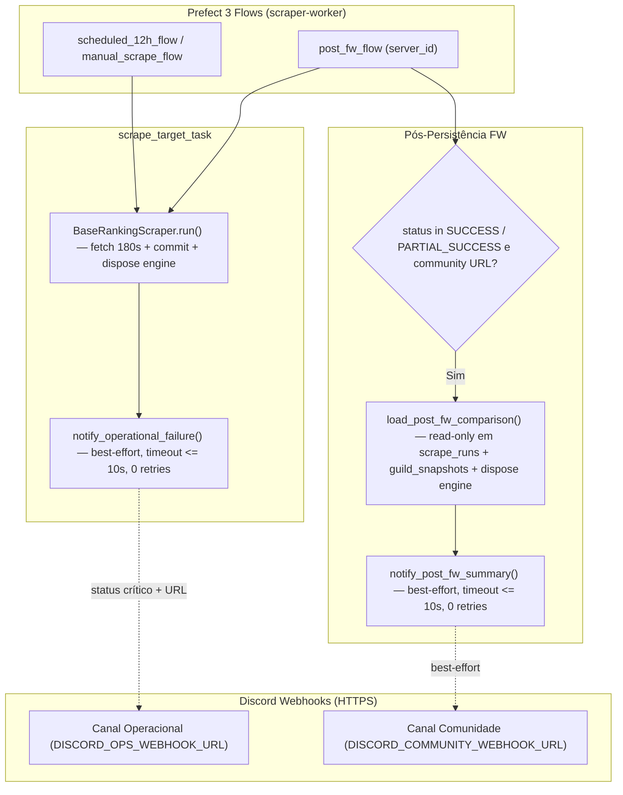

# Alertas Operacionais & Resumo Pós-FW via Discord (v2.0)

*   **Author:** richardman13
*   **Status:** Implemented
*   **Date:** 2026-11-22
*   **Approved Date:** 2026-11-22
*   **Source Brief:** [concepts_brief.md](../egm/002_discord_notifications/concepts_brief.md)

--------------------------------------------------------------------------------

## Overview

A versão **v2.0** adiciona uma camada de notificações assíncronas via webhooks do Discord no container `scraper-worker` existente. A solução reutiliza `httpx.AsyncClient` sem novos containers, sem portas públicas, sem novas dependências Python de *runtime* e sem alterações de schema ou migrações Alembic no PostgreSQL 16.

O recurso atende dois públicos distintos por meio de canais independentes e opcionais:
1. **Operador (`DISCORD_OPS_WEBHOOK_URL`):** recebe alertas imediatos em português quando uma execução encerra em falha crítica (`SCHEMA_DRIFT`, `LOW_COUNT_QUARANTINE`, `BLOCKED_CHALLENGE` ou `HTTP_ERROR`), incluindo execuções manuais com identificação explícita de `trigger_type`.
2. **Comunidade / Guilda (`DISCORD_COMMUNITY_WEBHOOK_URL`):** recebe um resumo automático pós-Fortress War (evento semanal de disputa de fortalezas no *Silkroad Online* — **SRO**) em português ao término bem-sucedido de `post_fw_flow` (`SUCCESS` ou `PARTIAL_SUCCESS`, este último indicando coleta aceita com `<= 5%` de erros de validação), comparando o snapshot atual com o baseline pré-FW nas últimas 24h (mudanças de posse em `fortress_held` e variação do Top 5 oficial de guildas em `guild_snapshots`).

## The Problem

Embora a v1.0 do **SRO Ranking Scraper** ([Design 001](001_sro_ranking_scraper_pipeline.md)) garanta auditoria em `scrape_runs`, quarentena local em `.html.gz` e séries temporais no PostgreSQL 16, duas lacunas permanecem:
1. **Detecção Tardia de Falhas Críticas:** Quebras de layout HTML (`SCHEMA_DRIFT`), quedas abruptas de contagem (`LOW_COUNT_QUARANTINE`), bloqueios Cloudflare Turnstile (`BLOCKED_CHALLENGE`) e erros persistentes de transporte (`HTTP_ERROR`) permanecem registrados em `scrape_runs` e nos logs JSON até que o operador consulte manualmente a UI do Prefect ou o banco.
2. **Resultados Pós-Fortress War Retidos no Banco:** O disparo extraordinário `post_fw_flow` captura o estado do servidor 30 minutos após o término da Fortress War, mas as trocas de fortalezas e a movimentação do Top 5 de guildas não são comunicadas automaticamente aos membros da guilda/comunidade.

A solução introduz o módulo `src/core/notifications.py` com execução *best-effort*, isolamento de falhas, mascaramento de tokens de webhook (`SecretStr`) e consultas portáveis com *partition pruning* em `guild_snapshots`.

## Goals

*   **G1 (Alertas Operacionais Imediatos):** Enviar notificação em português (timestamps em `YYYY-MM-DD HH:MM UTC`) via `DISCORD_OPS_WEBHOOK_URL` ao final de `scrape_target_task` para `SCHEMA_DRIFT`, `LOW_COUNT_QUARANTINE`, `BLOCKED_CHALLENGE` e `HTTP_ERROR`, cobrindo execuções `scheduled_12h`, `post_fw_extra` e `manual`.
*   **G2 (Resumo Automático Pós-Fortress War):** Enviar resumo em português via `DISCORD_COMMUNITY_WEBHOOK_URL` ao final de `post_fw_flow` quando o status for `SUCCESS` ou `PARTIAL_SUCCESS`, comparando todas as fortalezas presentes (`fortress_held`) e o Top 5 oficial de guildas (`guild_snapshots.rank_position <= 5`) contra o baseline pré-FW de até 24h.
*   **G3 (Isolamento de Falhas e Segurança de Segredos):** Executar notificações em modo *best-effort* após o `commit()` e fechamento da sessão/engine de banco (teto total `<= 10s`, `0 retries`, `follow_redirects=False`), operar em modo *no-op* silencioso quando a URL não estiver configurada, proteger credenciais via `SecretStr` + `hide_input_in_errors=True` + supressão de logs stdlib `httpx`/`httpcore` (sem expor a URL em logs ou exceções), neutralizar menções via `"allowed_mentions": {"parse": []}` e escapar Markdown em campos dinâmicos não confiáveis.
*   **G4 (Zero Overhead Estrutural):** Manter zero novos containers, zero portas públicas, zero novas dependências Python de *runtime* (declarando `aiosqlite` apenas em `[dependency-groups] dev` para a suíte de testes), zero migrações Alembic, conformidade com o teto de 512MB de RAM no `scraper-worker` e conformidade com `mypy --strict`, `ruff` e testes unitários com `respx` + SQLite.

## Non-Goals

*   **NG1 (Dashboard Analítico):** Camada de visualização interativa (Streamlit, Metabase, Power BI) permanece adiada para ciclo futuro.
*   **NG2 (Múltiplos Provedores de Mensageria):** Suporte a Telegram, Slack ou e-mail está fora do escopo da v2.0.
*   **NG3 (Deduplicação Stateful ou Alertas de Recuperação):** Não será criada tabela de histórico de notificações, máquina de estados nem alerta de recuperação (`falha -> saudável`).
*   **NG4 (Alertas para Status Não Críticos):** Execuções com status `SUCCESS`, `PARTIAL_SUCCESS`, `TARGET_MAINTENANCE` (manutenção programada do servidor alvo) e `SKIPPED_CIRCUIT_BREAKER` (execução pulada durante o cooldown de 6h do Circuit Breaker) não disparam alertas no canal operacional.
*   **NG5 (Dominância por Jogadores no Top 100):** O resumo pós-FW não consulta `character_snapshots` nem replica a view `v_guild_turnover_dominance` ([Design 001](001_sro_ranking_scraper_pipeline.md)); utiliza apenas o ranking oficial de guildas em `guild_snapshots`.
*   **NG6 (Novas Tasks Prefect ou Automações na UI):** Não serão criadas `@task` dedicadas no Prefect para envio de webhooks nem regras manuais na UI do Prefect.

## Open Questions

Todas as questões arquiteturais e de produto levantadas no brainstorm ([concepts_brief.md](../egm/002_discord_notifications/concepts_brief.md)) foram resolvidas antes desta aprovação. Não há questões em aberto.

## Critical User Journeys (CUJs)

### CUJ 1: Alerta Operacional em Falha Crítica (Agendada ou Manual)
*   **Given:** `DISCORD_OPS_WEBHOOK_URL` configurada no `.env` do `scraper-worker` e um alvo (ex.: `electus`) retornando desafio Cloudflare Turnstile (`HTTP 403`) ou layout HTML alterado (`SCHEMA_DRIFT`).
*   **When:** `scrape_target_task` conclui `scraper.run()` (persistindo `scrape_runs`, quarentena `.html.gz` e, quando aplicável, `circuit_breaker_until`), fecha a sessão e descarta a engine do PostgreSQL.
*   **Then:** O worker dispara um embed em português no canal privado do operador contendo servidor, status, `trigger_type`, `run_id`, código HTTP, duração, contagens de extração/erros, caminho da quarentena (ou `N/A`), `circuit_breaker_until` (quando aplicável) e resumo do erro, sem reverter dados nem alterar o retorno da task.

### CUJ 2: Resumo Automático Pós-Fortress War para a Comunidade
*   **Given:** `DISCORD_COMMUNITY_WEBHOOK_URL` configurada e uma execução `post_fw_flow(server_id="chronicle")` concluída com status `SUCCESS` ou `PARTIAL_SUCCESS`.
*   **When:** `post_fw_flow` abre uma sessão de leitura curta no PostgreSQL para carregar a comparação em `guild_snapshots` contra o último baseline válido das últimas 24h (`trigger_type != 'post_fw_extra'`, com fallback para qualquer run válido anterior nas últimas 24h), fecha a sessão e descarta a engine antes de enviar o webhook.
*   **Then:** O worker publica um embed em português no canal da comunidade com as trocas/manutenções de todas as fortalezas registradas e o Top 5 oficial de guildas com deltas de posição. Caso não exista baseline nas últimas 24h, publica apenas o retrato atual pós-FW com uma nota curta explicando a ausência de baseline.

### CUJ 3: Operação Segura sem Webhooks ou com Discord Indisponível
*   **Given:** Variáveis `DISCORD_OPS_WEBHOOK_URL` e/ou `DISCORD_COMMUNITY_WEBHOOK_URL` ausentes ou vazias (`""`), **ou** a API do Discord retornando `HTTP 429`/`500`/timeout.
*   **When:** Qualquer flow (`scheduled_12h_flow`, `post_fw_flow`, `manual_scrape_flow`) executa normalmente.
*   **Then:** Quando não configurada, a notificação retorna `False` silenciosamente sem tráfego de rede. Quando o Discord falha, a exceção é capturada, registrada em log JSON estruturado sem expor a URL do webhook (`error_type`, `http_status_code`, `channel`, `server_id`, `run_id`), e a task/flow encerra normalmente com os dados intactos no PostgreSQL.

--------------------------------------------------------------------------------

## Technical Plan (Architecture)

### 1. Arquitetura de Alto Nível e Fluxo de Execução

As notificações atuam como camada pós-persistência dentro do `scraper-worker`, fora da transação de escrita, fora do ciclo de vida da conexão PostgreSQL e fora do orçamento de `asyncio.timeout(180.0)` de `BaseRankingScraper.run()` ([base.py](../../src/scrapers/base.py)).



*   **Fronteira Explícita de Cobertura de Exceções Não Tratadas:** Caso ocorra falha antes do retorno de `ScrapeRunSummary` ([base.py](../../src/scrapers/base.py)) — por exemplo, queda do PostgreSQL (`OperationalError`) na abertura de sessão ou `server_id` inexistente (`LookupError` em `get_scraper()`) — o alerta operacional **não** é disparado, pois a falha ocorre fora do contrato canônico de status de `ScrapeRunSummary`. Esses casos permanecem visíveis nos logs JSON do container e no estado `Failed` da UI do Prefect.
*   **Contexto de Logs (`structlog`):** Como `BaseRankingScraper.run()` chama `clear_run_context()` ([logging.py](../../src/core/logging.py)) no `finally`, o módulo `src/core/notifications.py` recebe e registra explicitamente `server_id` e `run_id` em cada evento de log estruturado, garantindo correlação por `server_id` e `run_id`.

### 2. Configuração e Gestão de Segredos

#### `src/core/config.py`
Adicionar dois campos opcionais em `Settings` ([config.py](../../src/core/config.py)):
*   `discord_ops_webhook_url: SecretStr | None = None`
*   `discord_community_webhook_url: SecretStr | None = None`

Contrato de validação em duas etapas para acomodar `${VAR:-}` do Docker Compose sem vazar tokens em `ValidationError`:
1. **Configuração do modelo:** Habilitar `hide_input_in_errors=True` em `SettingsConfigDict`.
2. **Normalização (`mode="before"`):** Remover espaços nas bordas (`.strip()`, inclusive caso receba `SecretStr` programaticamente) e converter `None`, strings vazias (`""`) e strings somente com espaços para `None` (modo *no-op* silencioso). Nenhuma validação de URL que levante erro ocorre nesta fase.
3. **Validação de URL (`mode="after"` sobre `SecretStr | None`):** Quando não for `None`, extrair o segredo e validar:
   * Esquema `https`.
   * Host (`parsed.hostname`, reutilizando `urlsplit` já importado em `config.py`) pertencente à lista oficial de hosts de webhook do Discord: `{"discord.com", "discordapp.com", "ptb.discord.com", "canary.discord.com"}`.
   * Caminho contendo exatamente 4 segmentos não vazios após remover barra final: `["api", "webhooks", webhook_id, webhook_token]`.
   * Em caso de falha, levantar `ValueError` genérico sem incluir a URL na mensagem. Como a validação ocorre em `mode="after"` sobre `SecretStr` (e com `hide_input_in_errors=True`), o `ValidationError` nunca expõe o token cru em logs de inicialização.

#### `docker-compose.yml` & `.env.example`
*   Em `docker-compose.yml`, repassar no bloco `scraper-worker.environment`: `DISCORD_OPS_WEBHOOK_URL: ${DISCORD_OPS_WEBHOOK_URL:-}` e `DISCORD_COMMUNITY_WEBHOOK_URL: ${DISCORD_COMMUNITY_WEBHOOK_URL:-}`.
*   Em `.env.example`, documentar ambas as variáveis como opcionais com valor vazio por padrão.

### 3. Contrato do Módulo de Notificações (`src/core/notifications.py`)

Toda a lógica de formatação, consulta pós-FW e envio HTTP reside em `src/core/notifications.py`, preservando a estrutura de pacotes definida em [AGENTS.md](../../AGENTS.md).

#### Regras de Domínio e Tipos
*   **Status de alerta operacional:** `SCHEMA_DRIFT`, `LOW_COUNT_QUARANTINE`, `BLOCKED_CHALLENGE`, `HTTP_ERROR` (tipados com `ScrapeStatus` de [pydantic_schemas.py](../../src/models/pydantic_schemas.py)).
*   **Status elegíveis ao resumo pós-FW:** `SUCCESS`, `PARTIAL_SUCCESS` (tipados com `ScrapeStatus`).
*   **Limites operacionais:** teto total de envio `<= 10.0s` (`asyncio.timeout(10.0)`), `0 retries`, janela de baseline de `24h`, Top `5` guildas oficiais.
*   **Estruturas de dados imutáveis (`@dataclass(frozen=True, slots=True)`):**
    *   `GuildRankEntry`: `rank: int`, `guild_name: str`, `total_item_points: Decimal` (coergido via `Decimal(str(val))` na leitura caso o SQLite retorne `float`/`int`), `members_count: int`, `fortress_held: str | None`.
    *   `PostFWComparison`: `server_id: str`, `server_display_name: str`, `current_run_id: uuid.UUID`, `current_run_at: datetime`, `current_status: str` (alinhado a `ScrapeRunSummary.status: str` em [base.py](../../src/scrapers/base.py)), `baseline_run_id: uuid.UUID | None`, `baseline_run_at: datetime | None`, `current_fortresses: dict[str, str]` (`{fortress_name: guild_name}`), `baseline_fortresses: dict[str, str]` (`{fortress_name: guild_name}`), `current_top_guilds: tuple[GuildRankEntry, ...]` e `baseline_rank_by_guild: dict[str, int]` (`{guild_name: rank_position}`).

#### Interface Pública do Módulo
| Função | Assinatura / Retorno | Responsabilidade |
| :--- | :--- | :--- |
| `build_ops_alert_payload` | `(summary: ScrapeRunSummary) -> dict[str, Any]` | Monta payload JSON de alerta operacional com embed em PT-BR, `"allowed_mentions": {"parse": []}`, escape de Markdown e truncamento por campo. |
| `build_post_fw_payload` | `(comparison: PostFWComparison) -> dict[str, Any]` | Monta payload JSON de resumo pós-FW com embed em PT-BR, diff de fortalezas, Top 5 com deltas de posição, `"allowed_mentions": {"parse": []}` e escape de Markdown. |
| `send_discord_webhook` | `async (webhook_url: SecretStr \| None, payload: Mapping[str, Any], *, channel: Literal["ops", "community"], server_id: str, run_id: uuid.UUID) -> bool` | Envia `POST` assíncrono sob `asyncio.timeout(10.0)`, `httpx.Timeout(connect=5.0, read=10.0, write=5.0, pool=5.0)`, `follow_redirects=False` e `0 retries`. Retorna `True` em HTTP `2xx` (`200`/`204`), `False` em *no-op* ou falha (sem propagar exceção nem expor URL). |
| `notify_operational_failure` | `async (summary: ScrapeRunSummary, settings: Settings) -> bool` | Verifica `summary.status` nos status críticos e `settings.discord_ops_webhook_url`; envolve montagem do payload + envio em `try/except Exception`, retornando `False` com log sanitizado em qualquer falha. |
| `load_post_fw_comparison` | `async (session: AsyncSession, summary: ScrapeRunSummary) -> PostFWComparison \| None` | Executa consulta read-only portável em `servers`, `scrape_runs`, `guild_snapshots` e `guilds` ([db_models.py](../../src/models/db_models.py)) com *partition pruning* em `created_at` e normalização UTC. Retorna `None` se `summary.run_id` não existir no banco. |
| `notify_post_fw_summary` | `async (comparison: PostFWComparison \| None, settings: Settings) -> bool` | Se `comparison` e `settings.discord_community_webhook_url` estiverem presentes, envolve montagem do payload + envio em `try/except Exception`, retornando `False` com log sanitizado em qualquer falha. |

### 4. Contratos de Payload, Formatação e Segurança de Conteúdo

Todo payload enviado ao Discord obedece às seguintes invariantes:
*   **Neutralização de menções:** `"allowed_mentions": {"parse": []}` obrigatório na raiz do JSON.
*   **Escape de Markdown em texto não confiável:** Todos os campos dinâmicos raspados ou externos (`guild_name`, `fortress_held`, `quarantine_file_path`, `error_details.reason`) passam por escape de caracteres de controle Markdown (`\`, `*`, `_`, `` ` ``, `~`, `[`, `]`, `(`, `)`, `|`, `>`) e colapso de quebras de linha (`\r`/`\n` -> espaço), impedindo injeção de links mascarados (`[texto](https://...)`) no canal público e quebra de blocos inline.
*   **Idioma e timestamps:** Todos os textos em português (PT-BR), datas/horas normalizadas em UTC no formato `YYYY-MM-DD HH:MM UTC`, e pontuação (`total_item_points: Decimal`) arredondada para o inteiro mais próximo (`ROUND_HALF_UP`) com separador de milhar `.` em PT-BR (ex.: `Decimal("12345.67")` → `12.346 IP`, onde **IP** significa *Item Points*).
*   **Limites da API do Discord:** Truncamento por campo com sufixo `"..."` respeitando os limites do Discord (`title <= 256`, `description <= 4096`, `field.value <= 1024`, `footer.text <= 2048`). Com esses tetos individuais, o tamanho total do embed permanece abaixo de ~1.800 chars (ops) e ~2.500 chars (pós-FW), muito abaixo do limite agregado de 6.000 caracteres do Discord.

#### A. Alerta Operacional (`channel="ops"`)
*   **Cor do Embed:** `0xE74C3C` (vermelho) para `SCHEMA_DRIFT` e `LOW_COUNT_QUARANTINE`; `0xE67E22` (laranja) para `BLOCKED_CHALLENGE`; `0xF1C40F` (amarelo) para `HTTP_ERROR`.
*   **Título:** `[SRO Alert] {summary.server_id} — {summary.status}`
*   **Campos (`fields`):**
    *   `Servidor`, `Status`, `Gatilho` (`summary.trigger_type`), `HTTP Status` (`str(http_status_code)` ou `"N/A"`), `Duração` (`{execution_time_ms} ms`), `Extração / Erros` (`{records_extracted} extraídos / {validation_errors_count} erros`).
    *   `Run ID`: `` `{summary.run_id}` ``.
    *   `Quarentena`: `` `{quarantine_file_path}` `` quando presente, ou `"N/A"` (ex.: `HTTP_ERROR`, que não gera `.html.gz`).
    *   `Circuit Breaker` *(somente quando `summary.circuit_breaker_until is not None`)*: timestamp `YYYY-MM-DD HH:MM UTC`.
    *   `Detalhes` *(somente quando `summary.error_details is not None`, usando `ErrorDetails` de [pydantic_schemas.py](../../src/models/pydantic_schemas.py))*: `{failed_category}: {reason}` escapado e truncado a 1.024 caracteres.
*   **Rodapé (`footer.text`):** `SRO Ranking Scraper • {YYYY-MM-DD HH:MM UTC}` (obtido de `datetime.now(UTC)`, pois `ScrapeRunSummary` não possui `created_at`).

#### B. Resumo Pós-Fortress War (`channel="community"`)
*   **Cor do Embed:** `0x3498DB` (azul) para `SUCCESS`; `0xF39C12` (âmbar) para `PARTIAL_SUCCESS`.
*   **Título:** `Resumo Pós-Fortress War — {server_display_name}`
*   **Descrição:**
    *   Com baseline: `Comparação entre **{current_ts}** e baseline pré-FW (**{baseline_ts}**).`
    *   Sem baseline: `Retrato pós-FW em **{current_ts}**. *(Sem baseline pré-FW nas últimas 24h para comparação.)*`
    *   Quando `current_status == "PARTIAL_SUCCESS"`, anexa: ` *(Coleta parcial com <= 5% de erros de validação.)*`
*   **Campo `Fortalezas`:**
    *   Itera em ordem alfabética sobre a união das chaves de `current_fortresses` e `baseline_fortresses`.
    *   Sem fortalezas em ambos: `"Nenhuma fortaleza registrada neste snapshot."`
    *   Sem baseline: `• **{fortress}:** {curr_guild}`
    *   Com baseline (todos os 4 casos com o mesmo prefixo `• **{fortress}:**`): `• **{fortress}:** {curr_guild} (mantida)` quando igual; `• **{fortress}:** {prev_guild} → {curr_guild} (nova posse)` em troca; `• **{fortress}:** Sem dono → {curr_guild}` em conquista; `• **{fortress}:** {prev_guild} → Sem dono` em desocupação.
*   **Campo `Top 5 Guildas`:**
    *   Se vazio: `"Ranking de guildas indisponível neste snapshot."`
    *   Sem baseline (omite `[delta]` e espaço extra): `#{rank} **{guild_name}** — {total_item_points} IP ({members_count} membros)`.
    *   Com baseline: `#{rank} **{guild_name}** {delta} — {total_item_points} IP ({members_count} membros)`, onde `diff = baseline_rank - current_rank` (`(+N)` se subiu, `(-N)` se caiu, `(=)` se manteve, ou `(nova)` se não constava no snapshot de baseline). Pontos formatados em PT-BR arredondados ao inteiro mais próximo (`ROUND_HALF_UP`, ex.: `12.346 IP`).
*   **Rodapé (`footer.text`):** `Run {current_run_id} • {current_ts}`.

### 5. Estratégia de Baseline Pós-FW e Consulta Unificada em `guild_snapshots`

Todas as consultas utilizam SQLAlchemy 2.0 ORM/Core portável (sem `DISTINCT ON` ou `INTERVAL` literal em SQL bruto), executando tanto no **PostgreSQL 16** quanto em **SQLite** na suíte de testes. Como o SQLite descarta fuso horário de colunas `TIMESTAMP(timezone=True)`, `load_post_fw_comparison` normaliza todo `datetime` lido para UTC *aware* antes de calcular janelas ou formatar timestamps.

1. **Metadados do Servidor e Run Atual:**
   Consulta `ScrapeRun.created_at` (por `ScrapeRun.id == summary.run_id`) e `Server.display_name` (por `Server.id == summary.server_id`, definidos em [db_models.py](../../src/models/db_models.py)). Caso `ScrapeRun` não exista, retorna `None` e registra log de aviso.
2. **Seleção do Baseline Pré-FW (Janela de 24h):**
   Define `window_start = current_run_at - timedelta(hours=24)`.
   *   **Query Primária:** último `ScrapeRun` (`ORDER BY created_at DESC, id DESC LIMIT 1`) com `server_id == summary.server_id`, `id != summary.run_id`, `status IN ('SUCCESS', 'PARTIAL_SUCCESS')`, `created_at BETWEEN window_start AND current_run_at` e `trigger_type != 'post_fw_extra'`.
   *   **Query Fallback (executada somente se a primária retornar `None`):** mesma cláusula `WHERE` removendo `trigger_type != 'post_fw_extra'` (cobre reexecuções manuais consecutivas de `post_fw_flow` sem coleta `scheduled_12h` nas últimas 24h).
   *   **Sem Baseline:** se ambas retornarem `None`, `baseline_run_id = None` e o resumo publica apenas o retrato atual.
3. **Consulta Unificada em `guild_snapshots` com Partition Pruning:**
   Em `BaseRankingScraper.run()` ([base.py](../../src/scrapers/base.py)), `ScrapeRun.created_at` e todas as linhas de `GuildSnapshot.created_at` de uma execução são carimbadas com o mesmo timestamp UTC no momento da persistência (após o término do fetch de até 180s). Por isso, filtrar `GuildSnapshot.scrape_run_id == target_run_id` **e** `GuildSnapshot.created_at BETWEEN (target_run_at - 5 min) AND (target_run_at + 5 min)` cobre com folga variações de transação ou fixtures de teste enquanto garante *partition pruning* no PostgreSQL 16 (tocando 1 partição mensal, ou 2 próximo à virada do mês).
   *   **Snapshot Atual:** `JOIN` de `guild_snapshots` com `guilds` filtrando `server_id == summary.server_id`, `scrape_run_id == current_run_id`, faixa `±5 min` de `created_at` e `(rank_position <= 5 OR fortress_held IS NOT NULL)`, ordenado por `rank_position ASC`. Em memória, `current_top_guilds` filtra apenas as linhas com `rank_position <= 5` (excluindo detentoras de fortaleza fora do Top 5 da lista de Top 5).
   *   **Snapshot Baseline (quando `baseline_run_id is not None`):** mesma junção filtrando `server_id == summary.server_id`, `scrape_run_id == baseline_run_id`, faixa `±5 min` de `created_at` e `(guild_id IN current_top_guild_ids OR fortress_held IS NOT NULL)` (omitindo a cláusula `IN` caso `current_top_guild_ids` esteja vazio), ordenado por `rank_position ASC`.
   *   **Guardas de borda:** Strings `fortress_held` contendo apenas espaços em branco são ignoradas após strip; em caso de fortaleza duplicada em duas linhas por anomalia do servidor alvo, preserva-se deterministicamente a guilda de menor `rank_position`.

### 6. Integração na Orquestração

*   **`scrape_target_task` ([tasks.py](../../src/flows/tasks.py)):**
    1. Executa `summary = await scraper.run(session, trigger_type=trigger_type)` dentro do bloco `async with session_factory() as session:` (utilizando `create_engine_from_url` e `create_session_factory` de [database.py](../../src/core/database.py)).
    2. Fecha a sessão e executa `await engine.dispose()` no `finally`.
    3. Somente após liberar os recursos de banco, invoca `await notify_operational_failure(summary, settings=settings)` (que encapsula montagem + envio em `try/except Exception`) e retorna `summary`.
    4. Como `scheduled_12h_flow`, `post_fw_flow` e `manual_scrape_flow` delegam para `scrape_target_task`, os alertas ops cobrem os 3 gatilhos automaticamente.
*   **`post_fw_flow` ([orchestrator.py](../../src/flows/orchestrator.py)):**
    1. Executa `ensure_partitions_task()` e `summary = await scrape_target_task(server_id=server_id, trigger_type="post_fw_extra")`.
    2. Se `summary.status` for `SUCCESS` ou `PARTIAL_SUCCESS` e `settings.discord_community_webhook_url is not None`:
       * Fase de leitura (DB): abre sessão read-only efêmera dentro de `try/except Exception` (logando apenas `server_id`, `run_id`, `error_type` em falha de leitura), carrega `comparison = await load_post_fw_comparison(session, summary)`, fecha a sessão e executa `await engine.dispose()` no `finally`.
       * Fase de envio (HTTP): fora do ciclo de vida do banco, invoca `await notify_post_fw_summary(comparison, settings=settings)` (que encapsula montagem + envio em `try/except Exception`).
    3. Retorna `summary` intacto em qualquer cenário.

### 7. Segurança, Observabilidade e Isolamento de Falhas

*   **Proteção de Credenciais (Zero Vazamento):**
    *   `Settings` armazena ambas as URLs como `SecretStr | None` com `hide_input_in_errors=True` e validação em `mode="after"`.
    *   `get_secret_value()` é invocado exclusivamente no argumento de chamada HTTP dentro de `send_discord_webhook`.
    *   `configure_logging()` ([logging.py](../../src/core/logging.py)) ajusta os loggers stdlib `httpx` e `httpcore` para `logging.WARNING`, impedindo que o log `INFO` nativo do `httpx` registre `POST https://discord.com/api/webhooks/{id}/{token}` em execuções bem-sucedidas.
    *   Blocos `except` em `src/core/notifications.py` registram apenas `event`, `channel` (`"ops"` ou `"community"`), `server_id`, `run_id`, `http_status_code` (quando disponível) e `error_type=type(exc).__name__` — nunca `str(exc)`, `repr(exc)`, `exc_info=True` ou a URL.
*   **Isolamento Temporal e de Erros:** Limite de parede `asyncio.timeout(10.0)` + `httpx.Timeout(connect=5s, read=10s, write=5s, pool=5s)`, `follow_redirects=False`, `0 retries`, e captura de `Exception` nas duas fachadas públicas (`notify_operational_failure` e `notify_post_fw_summary`).
*   **Proteção Anti-Spam Stateless:** Sem tabela de controle, a cadência de 12h combinada ao Circuit Breaker de 6h (`SKIPPED_CIRCUIT_BREAKER` excluído dos alertas) limita o volume a no máximo 2 alertas/dia por servidor em estado de falha.

--------------------------------------------------------------------------------

## Alternatives Considered

### Alternative A: Dashboard Analítico (Streamlit / Metabase / Power BI) na v2.0
*   **Pros:** Exploração visual interativa das 5 views analíticas ([Design 001](001_sro_ranking_scraper_pipeline.md)) e séries temporais de jogadores.
*   **Cons:** Introduz novo container, aumento de consumo de RAM, exposição de porta HTTP/autenticação e manutenção contínua de front-end, sem resolver a detecção passiva de falhas críticas.
*   **Reason for Rejection:** Rejected by author — priorizou resolver primeiro a detecção de quebras operacionais mantendo o orçamento atual de RAM, zero portas públicas e zero manutenção de front-end; ficará para fase posterior.

### Alternative B: Suporte Simultâneo a Discord e Telegram
*   **Pros:** Flexibilidade multicanal para diferentes operadores ou comunidades.
*   **Cons:** Dobra formatação (MarkdownV2 vs Discord Embeds), variáveis de ambiente, validação de segredos e matriz de testes sem demanda real atual.
*   **Reason for Rejection:** Rejected by author — o operador utiliza apenas Discord; suportar dois provedores dobraria formatação, validação e testes sem ganho atual.

### Alternative C: Alertas Stateful (Apenas na Transição de Estado) com Tabela de Controle
*   **Pros:** Permite alertas de recuperação (`falha -> saudável`) e deduplicação por incidente.
*   **Cons:** Exige migração Alembic, nova tabela de estado, máquina de estados distribuída e cobertura extra de testes para um ganho marginal dado o volume baixo de execuções.
*   **Reason for Rejection:** Rejected by author — com cadência de 12h e Circuit Breaker de 6h, alertar em toda falha já limita o ruído a `<= 2` mensagens/dia por servidor e evita migração de schema e máquina de estados.

### Alternative D: Top 5 de Guildas Derivado de `character_snapshots.rank_position <= 100`
*   **Pros:** Alinhamento semântico direto com a view `v_guild_turnover_dominance`.
*   **Cons:** Obriga a consulta pós-FW a ler duas tabelas particionadas (`character_snapshots` e `guild_snapshots`) e agrega métricas diferentes do ranking oficial de guildas exibido nos sites dos servidores.
*   **Reason for Rejection:** Rejected by author — optou por ler diretamente as 5 primeiras posições do ranking oficial de guildas (`guild_snapshots.rank_position <= 5`), simplificando a consulta pós-FW para uma única tabela (`guild_snapshots`).

### Alternative E: Suprimir Alertas Operacionais em `manual_scrape_flow`
*   **Pros:** Evita mensagens no canal de ops durante testes manuais pontuais.
*   **Cons:** Cria exceção na regra stateless e remove o mecanismo mais simples de validar o webhook em produção via `--mode manual`.
*   **Reason for Rejection:** Rejected by author — manter o disparo com `trigger_type` explícito preserva a regra stateless e permite testar o webhook via `--mode manual` (usando `.env` sem URL em desenvolvimento local).

### Alternative F: Criar `@task` Dedicadas no Prefect para Envio de Webhooks
*   **Pros:** Visibilidade individual do envio de webhook como nó separado no grafo da UI do Prefect.
*   **Cons:** Adiciona ruído operacional e escrita extra no SQLite do `prefect-server` para uma chamada HTTP *best-effort* com `retries=0`.
*   **Reason for Rejection:** Rejected by author — descartado por adicionar overhead de estado no SQLite do `prefect-server` sem ganho funcional para uma chamada *best-effort* com `retries=0`.

--------------------------------------------------------------------------------

## Decision Log

*(Continuação do log iniciado em [Design 001](001_sro_ranking_scraper_pipeline.md), que contém `ADR-001` a `ADR-006`.)*

| ID | Date | Decision | Status | Rationale |
| :--- | :--- | :--- | :--- | :--- |
| ADR-007 | 2026-11-22 | Adotar webhooks do Discord em dois canais opcionais (`DISCORD_OPS_WEBHOOK_URL` e `DISCORD_COMMUNITY_WEBHOOK_URL`) tipados como `SecretStr \| None = None` em `Settings`, com `hide_input_in_errors=True`, normalização `"" -> None` (`mode="before"`) e validação HTTPS/hosts oficiais Discord (`mode="after"`). | Approved | Evita novos containers/dependências de runtime, impede vazamento de tokens em `ValidationError` ou logs e acomoda `${VAR:-}` do Docker Compose. |
| ADR-008 | 2026-11-22 | Alertas operacionais stateless disparados ao final de `scrape_target_task` (após `commit()` e `engine.dispose()`) para `SCHEMA_DRIFT`, `LOW_COUNT_QUARANTINE`, `BLOCKED_CHALLENGE` e `HTTP_ERROR`, incluindo `trigger_type="manual"`. | Approved | Evita migração de schema; cadência de 12h + Circuit Breaker de 6h limitam o ruído a `<= 2` alertas/dia por servidor e permitem validação via `--mode manual`. |
| ADR-009 | 2026-11-22 | Resumo pós-FW lendo exclusivamente `guild_snapshots` (com *partition pruning* em `created_at` e SQLAlchemy portável) para comparar todas as fortalezas (`fortress_held`) e o Top 5 oficial (`rank_position <= 5`). | Approved | Simplifica a consulta a uma única tabela particionada, preserva *partition pruning* no PostgreSQL 16 e mantém compatibilidade com SQLite nos testes unitários. |
| ADR-010 | 2026-11-22 | Seleção de baseline pós-FW priorizando o último run válido (`SUCCESS`/`PARTIAL_SUCCESS`) nas últimas 24h com `trigger_type != 'post_fw_extra'`, fallback para qualquer run válido anterior nas últimas 24h e degradação graciosa para retrato sem deltas. | Approved | Resiste a reexecuções manuais de `post_fw_flow` sem perder a comparação contra o estado pré-FW e evita falhas em servidores recém-cadastrados. |
| ADR-011 | 2026-11-22 | Consolidar o notificador em `src/core/notifications.py` com execução *best-effort* (`asyncio.timeout(10.0)`, `follow_redirects=False`, `0 retries`), idioma PT-BR, timestamps `YYYY-MM-DD HH:MM UTC`, `"allowed_mentions": {"parse": []}`, escape de Markdown e silenciamento dos loggers stdlib `httpx`/`httpcore`. | Approved | Preserva a estrutura de pacotes do `AGENTS.md`, neutraliza menções e links mascarados, elimina vazamento de URL via stdlib logging e impede que falhas externas afetem o pipeline. |

--------------------------------------------------------------------------------

## Non-Functional Requirements

### 1. Desempenho e Latência
*   **Orçamento de Tempo:** O envio de webhooks executa fora do `asyncio.timeout(180.0)` do fetch e fora do ciclo de vida das conexões PostgreSQL, com limite de parede `asyncio.timeout(10.0)` (`connect=5s`, `read=10s`, `write=5s`, `pool=5s`) e `0 retries`.
*   **Memória RAM:** Nenhuma nova dependência Python de *runtime* ou processo residente é adicionado ao `scraper-worker`, preservando o orçamento existente de **512MB de RAM**.
*   **Consulta Pós-FW:** As consultas em `guild_snapshots` filtram simultaneamente `scrape_run_id`, `server_id` e faixa `±5 min` de `created_at`, habilitando *partition pruning* com meta de execução `< 50ms`.

### 2. Segurança e Privacidade
*   **Proteção de Credenciais:** URLs de webhook são armazenadas como `SecretStr` com `hide_input_in_errors=True`, validadas contra hosts oficiais do Discord em `mode="after"`, e silenciadas nos loggers stdlib `httpx`/`httpcore`.
*   **Neutralização de Injeção de Conteúdo:** Todos os payloads incluem `"allowed_mentions": {"parse": []}` e escape de Markdown em campos dinâmicos não confiáveis.
*   **Zero Exposição de Rede:** Nenhuma porta adicional é aberta no `docker-compose.yml`; toda comunicação é de saída (*outbound HTTPS*, `follow_redirects=False`).

### 3. Confiabilidade e Portabilidade
*   **Isolamento de Falhas:** Erros de rede, HTTP `4xx`/`5xx`, erros de formatação ou indisponibilidade do Discord são capturados nas fachadas públicas e não propagam exceção para `scrape_target_task` ou `post_fw_flow`.
*   **Portabilidade SQL:** Queries do resumo pós-FW usam apenas construções SQLAlchemy 2.0 compatíveis tanto com PostgreSQL 16 (`asyncpg`) quanto com SQLite (`aiosqlite`) na suíte de testes, com normalização explícita de timestamps para UTC na leitura.

--------------------------------------------------------------------------------

## Detailed Implementation Plan

### Target Files to Create/Modify

#### 1. `src/core/config.py` (Modify)
*   **Type / Scope:** Configuração & Validação de Segredos.
*   **Proposed Changes:**
    *   Importar `SecretStr` de `pydantic` e ativar `hide_input_in_errors=True` em `SettingsConfigDict`.
    *   Adicionar `discord_ops_webhook_url: SecretStr | None = None` e `discord_community_webhook_url: SecretStr | None = None` em `Settings`.
    *   Implementar validador `mode="before"` aplicando `.strip()` (inclusive para `SecretStr`) e normalizando `None`, string vazia ou apenas espaços para `None`, e validador `mode="after"` verificando esquema `https`, `parsed.hostname` nos hosts oficiais do Discord e caminho exato de 4 segmentos `/api/webhooks/{id}/{token}` sem ecoar a URL no `ValueError`.

#### 2. `src/core/logging.py` (Modify)
*   **Type / Scope:** Telemetria & Supressão de Logs Stdlib Sensíveis.
*   **Proposed Changes:**
    *   Em `configure_logging()`, definir `logging.getLogger("httpx").setLevel(logging.WARNING)` e `logging.getLogger("httpcore").setLevel(logging.WARNING)` para impedir vazamento da URL do webhook em logs `INFO` da stdlib.

#### 3. `src/core/notifications.py` (Create)
*   **Type / Scope:** Módulo de Notificações Discord (Alertas Ops & Resumo Pós-FW).
*   **Proposed Changes:**
    *   Definir constantes de domínio (`OPS_ALERT_STATUSES`, `POST_FW_SUCCESS_STATUSES` tipadas com `ScrapeStatus`, limites de timeout/janela/embed) e dataclasses imutáveis tipadas (`GuildRankEntry` com `total_item_points: Decimal`, `PostFWComparison` com `current_status: str`, `baseline_run_id: uuid.UUID | None` e `baseline_run_at: datetime | None`).
    *   Implementar escape de Markdown, formatação PT-BR (`YYYY-MM-DD HH:MM UTC`, arredondamento `ROUND_HALF_UP` para `12.346 IP`), `build_ops_alert_payload` (rodapé via `datetime.now(UTC)`), `build_post_fw_payload`, `send_discord_webhook` (`asyncio.timeout(10.0)`, `follow_redirects=False`, `0 retries`), `notify_operational_failure`, `load_post_fw_comparison` (normalização UTC, coerção `Decimal(str(val))`, filtro `rank_position <= 5` em `current_top_guilds`, `ScrapeRun.id.desc()`, guarda para `current_top_guild_ids` vazio e strip de `fortress_held`) e `notify_post_fw_summary`.
    *   Capturar `Exception` sem propagação nas fachadas públicas (`notify_operational_failure` e `notify_post_fw_summary`) e emitir logs estruturados `structlog` passando sempre `run_id=str(run_id)` (evitando `TypeError` no `JSONRenderer` do `structlog` com `uuid.UUID`), além de `server_id`, `channel`, `http_status_code` e `error_type`.

#### 4. `src/flows/tasks.py` (Modify)
*   **Type / Scope:** Integração de Alertas Operacionais na Task de Scraping.
*   **Proposed Changes:**
    *   Importar `notify_operational_failure` de `src.core.notifications` com `# noqa: E402` (abaixo de `_ensure_accessible_prefect_home()`).
    *   Capturar `summary = await scraper.run(session, trigger_type=trigger_type)` dentro do bloco `try/finally` (garantindo fechamento da sessão e `await engine.dispose()`).
    *   Invocar `await notify_operational_failure(summary, settings=settings)` após o fechamento da sessão/engine e retornar `summary`.

#### 5. `src/flows/orchestrator.py` (Modify)
*   **Type / Scope:** Integração do Resumo Pós-FW no Flow `post_fw_flow`.
*   **Proposed Changes:**
    *   Importar `POST_FW_SUCCESS_STATUSES`, `load_post_fw_comparison` e `notify_post_fw_summary` de `src.core.notifications` com `# noqa: E402` (abaixo de `_ensure_accessible_prefect_home()`).
    *   Instanciar `logger = get_logger("orchestrator")` em `post_fw_flow`. Após `scrape_target_task(..., trigger_type="post_fw_extra")`, se `summary.status in POST_FW_SUCCESS_STATUSES` e `settings.discord_community_webhook_url is not None`, inicializar `engine: AsyncEngine | None = None`, executar `load_post_fw_comparison(session, summary)` em sessão read-only dentro de `try/except Exception` (logando `run_id=str(summary.run_id)`) e descartar `if engine is not None: await engine.dispose()` no `finally`.
    *   Após liberar os recursos de banco, invocar `await notify_post_fw_summary(comparison, settings=settings)` e retornar `summary`.

#### 6. `docker-compose.yml` (Modify)
*   **Type / Scope:** Orquestração de Containers.
*   **Proposed Changes:**
    *   Adicionar `DISCORD_OPS_WEBHOOK_URL: ${DISCORD_OPS_WEBHOOK_URL:-}` e `DISCORD_COMMUNITY_WEBHOOK_URL: ${DISCORD_COMMUNITY_WEBHOOK_URL:-}` em `scraper-worker.environment`.

#### 7. `.env.example` (Modify)
*   **Type / Scope:** Template de Variáveis de Ambiente.
*   **Proposed Changes:**
    *   Documentar `DISCORD_OPS_WEBHOOK_URL=` e `DISCORD_COMMUNITY_WEBHOOK_URL=` como variáveis opcionais vazias por padrão.

#### 8. `pyproject.toml` (Modify)
*   **Type / Scope:** Dependências de Desenvolvimento.
*   **Proposed Changes:**
    *   Declarar `aiosqlite` em `[dependency-groups] dev` (mantendo zero novas dependências de *runtime*).

#### 9. `tests/test_notifications.py` (Create)
*   **Type / Scope:** Testes Unitários do Módulo de Notificações.
*   **Proposed Changes:**
    *   Reutilizar `_run_async` (de `tests.test_validation`) para compatibilidade com sandbox Windows, `create_engine_from_url("sqlite+aiosqlite:///:memory:")` e `capsys` para captura de `structlog`.
    *   Provisionar fixture DDL SQLite mínima para as 4 tabelas (`servers`, `scrape_runs`, `guilds`, `guild_snapshots`) usando `TEXT NOT NULL DEFAULT '{}'` (sem `::jsonb`), `INTEGER PRIMARY KEY` em `guild_snapshots` e seed via parâmetros tipados `uuid.UUID` (ou `u.hex` sem hífens, compatível com `postgresql.UUID(as_uuid=True)` no SQLite).
    *   Testar `build_ops_alert_payload` para os 4 status críticos, `quarantine_file_path=None` (`N/A`), `circuit_breaker_until`, `trigger_type="manual"`, escape de Markdown, truncamento e `"allowed_mentions": {"parse": []}`.
    *   Testar `send_discord_webhook` com `respx`: HTTP 204, *no-op* (`None`), HTTP 429/500, `ConnectTimeout`, `follow_redirects=False`, `0 retries` (1 chamada) e `caplog.at_level(logging.INFO)` no logger raiz + `capsys` verificando ausência do token/URL nos logs e serialização válida de `run_id`.
    *   Testar `notify_operational_failure` (disparo nos 4 status críticos, silêncio nos demais, e isolamento se a formatação lançar erro).
    *   Testar `load_post_fw_comparison` em SQLite: baseline primário (`scheduled_12h`), fallback (`post_fw_extra`), sem baseline nas últimas 24h, normalização de `datetime` *naive*, filtro `rank_position <= 5` em `current_top_guilds` e `fortress_held` com apenas espaços em branco.
    *   Testar `build_post_fw_payload`: múltiplas fortalezas (troca, manutenção, conquista, desocupação, nenhuma), deltas do Top 5 (subida de fora do Top 5, queda, manutenção, nova guilda, sem baseline), arredondamento PT-BR (`Decimal("12345.67")` → `12.346 IP`) e neutralização de `[phishing](https://...)` e `@everyone`.

#### 10. `tests/test_models_db.py` (Modify)
*   **Type / Scope:** Testes de Configuração e Validação de Segredos.
*   **Proposed Changes:**
    *   Validar normalização `"" -> None`, espaços -> `None`, `.strip()` em URLs válidas, aceitação de hosts Discord oficiais, rejeição de `http://`, `https://:80`, domínios não-Discord e caminhos fora de `/api/webhooks/{id}/{token}`, e asserção de que o token cru não aparece em `str(exc_info.value)` no `ValidationError`.

#### 11. `tests/test_flows.py` (Modify)
*   **Type / Scope:** Testes de Integração nos Flows Prefect.
*   **Proposed Changes:**
    *   Atualizar `_make_test_settings()` para definir `discord_ops_webhook_url=None` e `discord_community_webhook_url=None` por padrão (com overrides opcionais), impedindo vazamento de variáveis do shell nos testes existentes.
    *   Verificar que `scrape_target_task` chama `notify_operational_failure` após fechar sessão/engine sem propagar exceção em caso de erro no webhook.
    *   Verificar que `post_fw_flow` fecha sessão/engine antes de chamar `notify_post_fw_summary` apenas em `SUCCESS`/`PARTIAL_SUCCESS` sem propagar exceção em caso de erro no banco ou no Discord.

#### 12. `README.md` (Modify)
*   **Type / Scope:** Documentação Operacional.
*   **Proposed Changes:**
    *   Documentar a configuração opcional de `DISCORD_OPS_WEBHOOK_URL` e `DISCORD_COMMUNITY_WEBHOOK_URL`, o comportamento *no-op* quando vazias, os eventos cobertos por cada canal e como testar o alerta ops via `--mode manual`.

--------------------------------------------------------------------------------

## Verification Plan

### 1. Gate de Qualidade de Código, Tipagem e Testes Automatizados
Executar o checklist obrigatório definido em [AGENTS.md](../../AGENTS.md):
```bash
ruff check .
ruff format --check .
mypy src tests
pytest --cov=src tests/
```
*   **Critério de aprovação:** Zero erros de lint/formatação no Ruff, zero erros no `mypy --strict` e toda a suíte de testes (`tests/`) passando sem chamadas de rede reais.

### 2. Verificação de Contrato Docker Compose e Validação de `Settings`
*   Executar `docker compose config` (com `.env` contendo `DISCORD_OPS_WEBHOOK_URL=` e `DISCORD_COMMUNITY_WEBHOOK_URL=` vazias) para confirmar interpolação correta das variáveis em `scraper-worker.environment` e ausência de novas portas expostas.
*   Confirmar a aceitação de variáveis vazias pelo `Settings` via `tests/test_models_db.py` e inicialização do CLI (`python -m src.flows.orchestrator --help`).

### 3. Teste Manual de Fumaça (Opcional com Webhook Real)
Configurar um canal privado de teste em `DISCORD_OPS_WEBHOOK_URL` e executar:
```bash
python -m src.flows.orchestrator --mode manual --target electus
```
*   **Critério de aprovação (execução normal):** Em alvo saudável (`SUCCESS`/`PARTIAL_SUCCESS`), o comando conclui com código `0` e nenhum alerta é enviado ao canal operacional.
*   **Critério de aprovação (falha injetada):** Ao apontar temporariamente `servers.base_url` do alvo de teste para um host inalcançável (induzindo `HTTP_ERROR`), o embed em PT-BR chega ao canal privado exibindo `trigger_type=manual`, sem expor a URL do webhook nos logs JSON ou stdlib do container.

--------------------------------------------------------------------------------

*Drafted with EGM*
