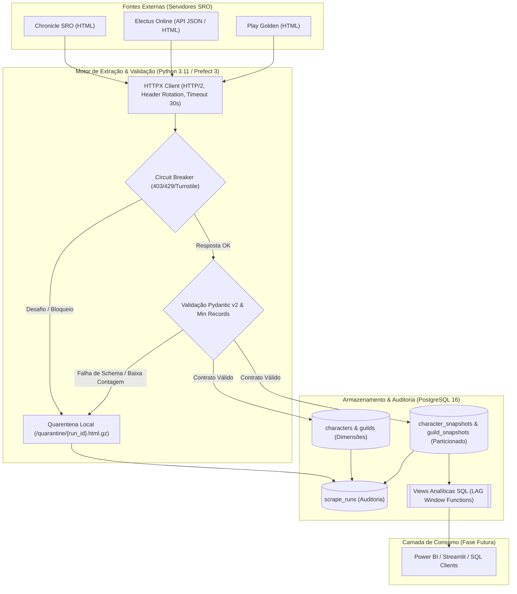

# SRO Ranking Scraper Pipeline (v1.0)

*   **Author:** richardman13
*   **Status:** Draft
*   **Date:** 2026-11-18

--------------------------------------------------------------------------------

## Overview

O **SRO Ranking Scraper** é um pipeline de dados containerizado projetado para transformar dados efêmeros de rankings públicos de servidores privados de Silkroad Online (**Chronicle SRO**, **Electus Online** e **Play Golden**) em séries temporais imutáveis e auditáveis no PostgreSQL 16.

O sistema opera sob cadência regular de 12 horas combinada com um gatilho extraordinário pós-Fortress War (FW). Através de um modelo append-only e views analíticas orientadas a window functions (`LAG()`), o projeto viabiliza a medição de atividade real de jogadores, retenção semanal, dinâmicas de poder entre guildas e balanceamento de raças (Chinese vs European), estabelecendo bases analíticas sólidas para consumo posterior em ferramentas como Power BI ou Streamlit.

## The Problem

Os rankings públicos de servidores privados de Silkroad Online apresentam desafios críticos para análise histórica:
1. **Natureza Efêmera e Perda de Histórico:** Sites de servidores privados mantêm apenas o estado presente dos rankings. Mudanças diárias de nível, pontuação de itens (Item Points) e turnover de membros de guilda são sobrescritas continuamente, tornando impossível medir a evasão de jogadores ou a curva de atividade ao longo do ciclo de vida do servidor.
2. **Volatilidade Operacional e Schema Drift:** Servidores privados frequentemente alteram layouts HTML, URLs de paginação ou ativam proteções de tráfego (Cloudflare Turnstile) sem aviso prévio. Crawlers frágeis quebram silenciosamente ou gravam dados parciais corrompidos no banco.
3. **Distorção por Bots e Doações:** Servidores de Silkroad são fortemente impactados por automação desassistida (bots de grind 24/7) e compra direta de equipamentos via doações financeiras. Rankings estáticos agregam esses perfis sem distinguir esforço legítimo de doação ou automação contínua.

A solução consiste em desacoplar a ingestão da análise, extraindo dados tabulares via HTTPX com isolamento estrito de falhas por alvo, validação de schema duplo (Pydantic v2 + limiar mínimo de registros), quarentena automática de payloads anômalos e persistência append-only com views SQL normalizadas por hora.

## Goals

*   **G1 (Extração Resiliente e Isolada):** Coletar dados de ranking (Personagens e Guildas) dos 3 servidores alvo (Chronicle, Electus, Play Golden) a cada 12h e pós-FW, garantindo que falhas em um alvo não afetem a execução dos demais.
*   **G2 (Integridade Append-Only e Auditoria):** Registrar 100% das execuções na tabela `scrape_runs` e persistir snapshots de forma estritamente aditiva (sem UPDATEs ou DELETEs em dados históricos).
*   **G3 (Prevenção de Schema Drift e Quarentena):** Validar contratos via Pydantic v2 e aplicar limiar mínimo de registros (`min_records_threshold`). Payloads que falharem na validação devem ser desviados para quarentena local compactada (`.html.gz`) sem poluir o banco.
*   **G4 (Geração de Séries Temporais Analíticas):** Disponibilizar Views SQL nativas no PostgreSQL com window functions para cálculo de taxas horárias de atividade (`rate_per_hour`), classificação heurística de bots vs doadores, dominância no Top 100 e retenção semanal.

## Non-Goals

*   **NG1 (Deep Scraping de Perfis):** Rastrear inventários detalhados, grau de refino (+plus) de itens ou árvores de skills por personagem na v1.0.
*   **NG2 (Telemetria em Tempo Real):** Inspecionar chat global, logs de alquimia ou spawn/morte de Uniques ao vivo.
*   **NG3 (Bypasses Pagos ou Infraestrutura Pesada):** Utilizar serviços comerciais de resolução de CAPTCHA, pools de proxies rotativos pagos ou orquestradores com JVM (Spark/Airflow).
*   **NG4 (Alertas Externos e Interfaces Gráficas):** Desenvolver bots para Discord/Telegram ou dashboards no Streamlit/Power BI nesta primeira versão.

## Open Questions

*   **Q1:** A rota de ranking do Electus Online permite consumo direto de endpoint JSON ou requer bypass de cabeçalhos/cookies específicos de sessão? *(Será investigado na fase de mapeamento técnico do scraper).*
*   **Q2:** A Fortress War ocorre exatamente no mesmo horário e dia da semana nos 3 servidores? *(Padrão configurável por servidor na tabela `servers`).*

## Critical User Journeys (CUJs)

### CUJ 1: Ingestão Agendada Periódica (Ciclo de 12 Horas)
*   **Given:** Containers do PostgreSQL 16 e Prefect 3 em execução e servidores alvo acessíveis.
*   **When:** O agendador Cron do Prefect dispara o flow principal às 00:00 ou 12:00 UTC.
*   **Then:** O worker extrai os rankings de cada alvo via HTTPX, valida contra os modelos Pydantic v2, grava a auditoria em `scrape_runs` e insere os registros append-only nas partições de `character_snapshots` e `guild_snapshots`.

### CUJ 2: Tratamento de Schema Drift ou Bloqueio Anti-Bot
*   **Given:** Um dos servidores (ex: Electus) altera sua estrutura de classes CSS ou apresenta tela de desafio Cloudflare Turnstile (HTTP 403 / cf-challenge).
*   **When:** O scraper do alvo específico detecta erro de parsing, registros abaixo do limiar ou assinatura do Turnstile.
*   **Then:** O Circuit Breaker abre para aquele alvo específico, o HTML bruto da resposta é compactado e armazenado em `/quarantine/{target}/{run_id}.html.gz`, o status `SCHEMA_DRIFT` ou `BLOCKED_CHALLENGE` é registrado em `scrape_runs`, e o pipeline prossegue com a coleta dos outros alvos sem interrupção.

### CUJ 3: Consulta Analítica de Séries Temporais
*   **Given:** Ao menos 3 dias de coletas executadas com sucesso no banco.
*   **When:** Um analista ou ferramenta de BI executa `SELECT * FROM v_character_activity_deltas` ou `v_bot_vs_donor_classification`.
*   **Then:** A query retorna deltas normalizados por hora (`rate_per_hour`) e segmentação comportamental sem necessidade de pré-processamento manual em Python.


--------------------------------------------------------------------------------

## Technical Plan (Architecture)

### 1. High-Level Architecture & Data Flow

O pipeline é orquestrado de forma totalmente desacoplada através do **Prefect 3**, executando em containers Docker sobre rede isolada. O fluxo de dados opera em quatro etapas síncronas por servidor: **Extração**, **Validação & Quarentena**, **Persistência Append-Only** e **Disponibilização Analítica**.



### 2. Topologia de Infraestrutura (Docker Compose)

O ambiente operacional é composto por 3 serviços orquestrados via `docker-compose.yml`:
1. **`postgres`:** PostgreSQL 16 com volume persistente montado em disco (`postgres_data`). Configurado com parâmetros de memória ajustados para consultas analíticas (`shared_buffers = 512MB`, `work_mem = 64MB`).
2. **`prefect-server`:** Backend self-hosted do Prefect 3 expondo a UI e API local (`localhost:4200`). Utiliza um banco SQLite dedicado montado em volume ou schema isolado no Postgres.
3. **`scraper-worker`:** Container Python 3.11 executando o Prefect Runner / Worker. Possui acesso à rede externa para saída HTTP aos servidores de jogo e rede interna para comunicação com `postgres` e `prefect-server`. Monta volume compartilhado `./quarantine` para gravação de diagnósticos.

### 3. Motor de Extração HTTP-First & Circuit Breaker

* **Sessão HTTPX Otimizada:** Cada execução utiliza cliente assíncrono `httpx.AsyncClient` com suporte a `http2=True`, limites estritos de conexões (`httpx.Limits(max_keepalive_connections=5, max_connections=10)`), timeouts específicos (Connect: 10s, Read: 30s) e rotação determinística de cabeçalhos legítimos (`User-Agent`, `Accept-Language`, `Sec-Ch-Ua`).
* **Design Pattern Strategy por Alvo:**
  * `BaseRankingScraper`: Classe base abstrata que encapsula retries exponenciais, medição de tempo, logging estruturado (`structlog`) e registro na tabela `scrape_runs`.
  * `ChronicleScraper`: Implementa parsing tabular HTML via `lxml` com seletores CSS fixados em `table.ranking-table tbody tr`.
  * `ElectusScraper`: Prioriza inspeção de endpoints JSON de paginação interna (`/api/ranking/...`). Emprega decodificação rápida via `orjson`.
  * `PlayGoldenScraper`: Implementa parsing HTML padrão para templates clássicos de vSRO.
* **Lógica do Circuit Breaker:**
  * O crawler inspeciona status HTTP (`403`, `429`) e assinaturas textuais no corpo/headers (ex: `<div id="turnstile-wrapper">`, tokens `cf-chl-bypass`, `cf-mitigated: challenge`).
  * Ao detectar bloqueio interativo Cloudflare Turnstile, o circuito transiciona para estado `OPEN` para aquele alvo específico.
  * O alvo é suspenso imediatamente pelo período de cooldown (6 horas), gravando status `BLOCKED_CHALLENGE` em `scrape_runs`, prevenindo loops de retentativas que provocam blacklist de IP.

### 4. Validação de Contratos & Sistema de Quarentena

* **Schemas Pydantic v2 Tipados com Suporte a Atributos Dinâmicos (JSONB):**
  A validação separa campos essenciais e comuns de atributos exclusivos de cada servidor (armazenados em `extra_metrics`), além de contemplar o ranking dedicado de Job com colunas `Level` e `Exp`:

  ```python
  from typing import Any, Literal, Optional
  from pydantic import BaseModel, ConfigDict, Field, field_validator


  class RawPlayerRankingItem(BaseModel):
      model_config = ConfigDict(strict=False, str_strip_whitespace=True)

      # --- Campos Core (Obrigatórios - quebram o lote se falharem) ---
      rank: int = Field(ge=1)
      char_name: str = Field(min_length=1, max_length=64)
      level: int = Field(ge=1, le=140)

      # --- Campos Padronizados (Comuns entre os servidores) ---
      guild_name: Optional[str] = None
      race: Optional[Literal["CH", "EU"]] = None
      item_points: Optional[float] = Field(default=None, ge=0)
      strength: Optional[int] = Field(default=None, ge=0)
      intellect: Optional[int] = Field(default=None, ge=0)
      title: Optional[str] = None

      # --- Ecossistema de Job & Honor ---
      job_type: Optional[Literal["TRADER", "THIEF", "HUNTER"]] = None
      job_level: Optional[int] = Field(default=None, ge=0)
      job_points: Optional[int] = Field(default=None, ge=0)
      job_exp: Optional[int] = Field(default=None, ge=0)
      honor_points: Optional[int] = Field(default=None, ge=0)

      # --- Atributos Exclusivos por Servidor (Persistidos em JSONB) ---
      # Ex: gold, sox_parts, last_logout, elo_points, unique_points, hours_played, pvp_kd
      extra_metrics: dict[str, Any] = Field(default_factory=dict)

      @field_validator("guild_name", "title", mode="before")
      @classmethod
      def normalize_empty_strings(cls, v: Any) -> Optional[str]:
          if v is None:
              return None
          cleaned = str(v).strip()
          if cleaned in {"", "-", "None", "No Name", "XXXX", "N/A"}:
              return None
          return cleaned

      @field_validator("job_type", mode="before")
      @classmethod
      def normalize_job_type(cls, v: Any) -> Optional[str]:
          if not v:
              return None
          val = str(v).strip().upper()
          mapping = {
              "TRADER": "TRADER",
              "MERCADOR": "TRADER",
              "THIEF": "THIEF",
              "LADRÃO": "THIEF",
              "HUNTER": "HUNTER",
              "CAÇADOR": "HUNTER",
          }
          return mapping.get(val)

      @field_validator(
          "strength",
          "intellect",
          "job_level",
          "job_points",
          "job_exp",
          "honor_points",
          mode="before",
      )
      @classmethod
      def clean_int_numbers(cls, v: Any) -> Optional[int]:
          if v is None or v == "":
              return None
          if isinstance(v, int):
              return v
          digits = "".join(filter(str.isdigit, str(v)))
          return int(digits) if digits else None


  class RawJobRankingItem(BaseModel):
      model_config = ConfigDict(strict=False, str_strip_whitespace=True)

      rank: int = Field(ge=1)
      char_name: str = Field(min_length=1, max_length=64)
      job_type: Literal["TRADER", "THIEF", "HUNTER"]
      job_level: int = Field(ge=1, le=140)
      job_exp: Optional[int] = Field(default=None, ge=0)
      guild_name: Optional[str] = None
      extra_metrics: dict[str, Any] = Field(default_factory=dict)

      @field_validator("job_type", mode="before")
      @classmethod
      def normalize_job_type(cls, v: Any) -> str:
          val = str(v).strip().upper()
          mapping = {
              "TRADER": "TRADER",
              "MERCADOR": "TRADER",
              "THIEF": "THIEF",
              "LADRÃO": "THIEF",
              "HUNTER": "HUNTER",
              "CAÇADOR": "HUNTER",
          }
          return mapping.get(val, val)

      @field_validator("job_level", "job_exp", mode="before")
      @classmethod
      def clean_int_numbers(cls, v: Any) -> Optional[int]:
          if v is None or v == "":
              return None
          if isinstance(v, int):
              return v
          digits = "".join(filter(str.isdigit, str(v)))
          return int(digits) if digits else None
  ```
* **Critério de Detecção de Drift:**
  * Rejeição total do lote se `validation_errors / total_records > 0.05` (mais de 5% de quebra) ou se campos core (`rank`, `char_name`, `level`) forem corrompidos.
  * Rejeição por contagem mínima (`min_records_threshold`): Chronicle (min 100), Electus (min 100), Play Golden (min 50). Se a resposta retornar menos linhas, assume-se que o seletor quebrou ou o site está em manutenção vazia.
* **Mecanismo de Quarentena (Dead-Letter):**
  * Em vez de salvar HTMLs pesados no banco de dados, o arquivo bruto é compactado com `gzip` e salvo em `./quarantine/{server_id}/{run_id}.html.gz`.
  * A tabela `scrape_runs` armazena apenas o hash `sha256`, o tamanho em bytes e o caminho do arquivo, preservando a performance do PostgreSQL.

### 5. Modelagem de Dados Relacional & Temporal (PostgreSQL 16)

O banco é projetado sob o princípio estrito de **append-only** e separação de dimensões e fatos:

```sql
-- Dimensões
-- servers: Configuração dos alvos, URLs, status e limiares
-- characters: Identidade única UUID por personagem, mantendo first_seen_at e last_seen_at
-- guilds: Identidade única UUID por guilda e server_id

-- Tabela de Auditoria
-- scrape_runs: Registra cada disparo (ID, status, records_extracted, records_persisted, execution_time_ms, quarantine_path)

-- Fatos Temporais (Append-Only com Particionamento Mensal por scraped_at)
-- character_snapshots: 
--   id (BIGINT IDENTITY), scrape_run_id (UUID), server_id (VARCHAR), character_id (UUID), guild_id (UUID),
--   rank (INT), level (INT), xp (BIGINT), item_points (NUMERIC),
--   strength (INT), intellect (INT), title (VARCHAR),
--   job_type (VARCHAR), job_level (INT), job_points (INT), job_exp (BIGINT), honor_points (INT),
--   extra_metrics (JSONB NOT NULL DEFAULT '{}'::jsonb),
--   scraped_at (TIMESTAMPTZ)
-- guild_snapshots: 
--   id (BIGINT IDENTITY), scrape_run_id (UUID), server_id (VARCHAR), guild_id (UUID),
--   rank (INT), members_count (INT), total_item_points (NUMERIC), fortress_held (VARCHAR),
--   extra_metrics (JSONB NOT NULL DEFAULT '{}'::jsonb),
--   scraped_at (TIMESTAMPTZ)
```

* **Indexação:**
  * Índice composto B-Tree em `(server_id, character_id, scraped_at DESC)` para aceleração do `LAG()`.
  * Índice BRIN em `scraped_at` para filtros temporais analíticos de longo prazo em tabelas particionadas.
  * Índice GIN em `character_snapshots USING gin (extra_metrics)` para indexação e consultas performáticas sobre atributos específicos de cada servidor no PostgreSQL.

### 6. Camada Analítica SQL (Views Nativas)

1. **`v_character_activity_deltas`:** Utiliza `LAG(...) OVER (PARTITION BY server_id, character_id ORDER BY scraped_at)` para calcular deltas de XP, Item Points e Job Points. Normaliza todos os deltas em taxa horária contínua (`xp_rate_per_hour = delta_xp / hours_diff`), corrigindo distorções causadas pelo snapshot extraordinário pós-Fortress War.
2. **`v_bot_vs_donor_classification`:** Segmenta perfis em janelas de 7 dias através da persistência de grind e variância de XP:
   * **`SUSPECTED_BOT_24_7`:** Proporção de intervalos ativos >= 90%, desvio padrão de taxa de XP < 35% da média, taxa média de XP > 1000/h.
   * **`SUSPECTED_DONATOR_WHALE`:** Salto abrupto de Item Points >= 150 pontos em um único intervalo, com proporção de grind de XP < 60%.
   * **`HARDCORE_HUMAN`:** Taxa de atividade entre 50% e 89%, com pausas humanas detectadas.
3. **`v_guild_turnover_dominance`:** Agrega market share e contagem de membros no Top 50 e Top 100 por guilda.
4. **`v_race_balance_ch_vs_eu`:** Apresenta média de Item Points, distribuição de nível e share populacional entre Chinese e European.
5. **`v_server_retention_weekly`:** Calcula taxa percentual de Weekly Active Characters (WAC) com evolução positiva de métricas semana a semana.


--------------------------------------------------------------------------------

## Alternatives Considered

Nesta seção são documentadas as abordagens arquiteturais e tecnológicas avaliadas e rejeitadas durante a concepção do pipeline, acompanhadas de suas justificativas técnicas e trade-offs.

### Alternative A: Playwright / Headless Browser como Motor Padrão de Extração

*   **Pros**:
    *   Execução nativa de código JavaScript e renderização idêntica à de um navegador real.
    *   Facilidade para contornar desafios simples de front-end ou SPAs dinâmicas.
*   **Cons**:
    *   Consumo proibitivo de recursos (300MB a 600MB de RAM por instância de browser Chromium).
    *   Necessidade de imagens Docker pesadas com dependências de sistema (fontes, bibliotecas gráficas, drivers).
    *   Vulnerabilidade crônica a detecção automatizada de headless por sistemas avançados de proteção (assinaturas de WebDriver, canvas fingerprinting).
    *   Latência elevada para extrair múltiplas páginas tabulares em comparação com requisições HTTP diretas.
*   **Reason for Rejection**: `Rejected by author: Overhead operacional incompatível com a premissa de stack lean e fragilidade sob detecção anti-bot em containers. A abordagem HTTPX com suporte a HTTP/2 e pooling fornece máxima eficiência e throughput para dados tabulares e APIs JSON.`

### Alternative B: Orquestração Pesada com Apache Airflow ou Apache Spark

*   **Pros**:
    *   Capacidade de processamento distribuído massivo em escala de petabytes.
    *   Ecosistema estabelecido com centenas de operadores prontos.
*   **Cons**:
    *   Sobrecarga severa de JVM e múltiplos serviços dependentes (Webserver, Scheduler, Celery Workers, Redis, Metastore), demandando vários gigabytes de RAM.
    *   Complexidade desproporcional para um pipeline com cadência de 12 horas e apenas 3 alvos.
*   **Reason for Rejection**: `Rejected by author: Violação direta do requisito não negociável de stack leve e containerizada. O Prefect 3 self-hosted atende com perfeição à orquestração de sub-flows com isolamento e retries nativos consumindo menos de 150MB de memória.`

### Alternative C: Persistência de HTMLs Brutos em Colunas BYTEA/TEXT no PostgreSQL

*   **Pros**:
    *   Centralização estrita de todos os dados em uma única base relacional com garantias ACID.
*   **Cons**:
    *   Geração acelerada de *table bloat* e consumo excessivo de I/O de disco no banco.
    *   Armazenamento de payloads em tabelas TOAST desacelera scans sequenciais e consultas analíticas nas tabelas principais.
*   **Reason for Rejection**: `Rejected by author: Risco crítico de degradação de performance do PostgreSQL para queries analíticas. Optou-se pela solução Dead-Letter Quarantine no sistema de arquivos local (/quarantine/{target}/{run_id}.html.gz), registrando no banco apenas o caminho e o hash SHA-256 para auditoria.`

### Alternative D: Cálculo de Deltas de XP e Pontos via LAG() Direto (Sem Normalização Temporal)

*   **Pros**:
    *   Expressão SQL marginalmente mais simples (`xp - LAG(xp)` sem divisão por tempo decorrido).
*   **Cons**:
    *   Distorção matemática nas séries temporais aos domingos: o disparo extraordinário pós-Fortress War cria um intervalo de apenas 3 a 4 horas em relação ao snapshot anterior, fazendo com que deltas brutos pareçam quedas de atividade quando comparados com intervalos normais de 12 horas.
*   **Reason for Rejection**: `Rejected by author: Indução de viés analítico severo na medição de velocidade de farm e retenção. Adotou-se o cálculo normalizado de taxa horária contínua (rate_per_hour = delta / hours_since_last_snapshot).`


--------------------------------------------------------------------------------

## Non-Functional Requirements

### 1. Performance & Latency
*   **Tempo de Execução por Alvo:** Cada execução de raspagem por servidor não deve exceder 60 segundos de tempo total de processamento (incluindo requisições HTTP, paginação e persistência).
*   **Consumo de Recursos em Container:** O container `scraper-worker` deve operar dentro de um teto de 512MB de memória RAM, viabilizado pela ausência de browsers headless. O `postgres` é dimensionado para até 1GB de RAM.
*   **Throughput de Banco:** Inserções append-only devem utilizar `bulk_insert_mappings` ou `COPY` do PostgreSQL via SQLAlchemy 2.0 Core / `asyncpg` para persistir centenas ou milhares de linhas em menos de 500ms por snapshot.

### 2. Segurança & Conectividade
*   **Isolamento de Rede:** Acesso ao banco de dados PostgreSQL exposto exclusivamente na rede interna do Docker (`sro_network`), sem binding de portas públicas em produção.
*   **Gestão de Segredos:** Credenciais do banco e tokens de API gerenciados estritamente via variáveis de ambiente injetadas pelo Docker Compose (`.env`), sem secrets hardcoded no código.
*   **Proteção do IP do Host:** O Circuit Breaker deve impedir repetições contínuas contra alvos protegidos por Cloudflare, evitando bloqueio definitivo do IP da infraestrutura.

### 3. Armazenamento & Particionamento
*   **Particionamento Mensal:** As tabelas de fatos `character_snapshots` e `guild_snapshots` utilizam particionamento por faixa de data (`RANGE (scraped_at)`). Scripts ou migrações gerenciam partições futuras para evitar degradação de índices e viabilizar expurgo ou arquivamento de partições antigas no futuro sem bloqueios de tabela.

--------------------------------------------------------------------------------

## Detailed Implementation Plan

Esta seção descreve todas as alterações e arquivos que serão criados ou atualizados para viabilizar a implementação completa da v1.0.

### Target Files to Create/Modify

#### 1. `docker-compose.yml` (Create)
*   **Type / Scope:** Infraestrutura / Orquestração de Containers.
*   **Proposed Changes:**
    *   Definir serviço `postgres` (imagem `postgres:16-alpine`), portas internas, volume `postgres_data`, variáveis de ambiente e healthcheck via `pg_isready`.
    *   Definir serviço `prefect-server` (imagem `prefecthq/prefect:3-python3.11`), comando `prefect server start --host 0.0.0.0`, expondo porta `4200` e volume para dados do Prefect.
    *   Definir serviço `scraper-worker` construído a partir do `Dockerfile` local, configurado com `depends_on` condicional ao healthcheck do `postgres` e `prefect-server`, montando o volume `./quarantine:/app/quarantine`.

#### 2. `Dockerfile` (Create)
*   **Type / Scope:** Infraestrutura / Build do Scraper.
*   **Proposed Changes:**
    *   Imagem base `python:3.11-slim`.
    *   Instalação de pacotes essenciais do sistema operacional (`curl`, `gcc`, `libpq-dev`).
    *   Instalação e configuração do gerenciador de dependências (`uv` ou `pip`).
    *   Cópia do código-fonte para `/app`, configuração de `PYTHONPATH=/app/src` e usuário não-root para execução segura.

#### 3. `pyproject.toml` (Create)
*   **Type / Scope:** Gerenciamento de Dependências do Projeto.
*   **Proposed Changes:**
    *   Dependências de produção: `prefect>=3.0.0`, `sqlalchemy>=2.0.0`, `pydantic>=2.7.0`, `pydantic-settings>=2.2.0`, `httpx[http2]>=0.27.0`, `beautifulsoup4>=4.12.0`, `lxml>=5.2.0`, `orjson>=3.10.0`, `psycopg[binary]>=3.1.0`, `structlog>=24.1.0`, `alembic>=1.13.0`.
    *   Dependências de teste e qualidade: `pytest>=8.0.0`, `pytest-asyncio>=0.23.0`, `respx>=0.21.0`, `ruff>=0.4.0`.

#### 4. `alembic.ini` & `alembic/env.py` (Create)
*   **Type / Scope:** Migrações de Banco de Dados.
*   **Proposed Changes:**
    *   Configuração do mecanismo de migração Alembic para conectar via `DATABASE_URL` do ambiente e carregar os metadados dos modelos SQLAlchemy 2.0.

#### 5. `alembic/versions/001_initial_schema.py` (Create)
*   **Type / Scope:** DDL do PostgreSQL 16.
*   **Proposed Changes:**
    *   Criação das tabelas de dimensão: `servers`, `characters`, `guilds`.
    *   Criação da tabela de auditoria: `scrape_runs`.
    *   Criação das tabelas de fatos particionadas: `character_snapshots` e `guild_snapshots` (incluindo campos `job_level`, `job_exp`, `extra_metrics JSONB`).
    *   Criação de partições iniciais por mês e índices B-Tree, BRIN e GIN.

#### 6. `alembic/versions/002_analytical_views.py` (Create)
*   **Type / Scope:** DDL de Views Analíticas.
*   **Proposed Changes:**
    *   Criação das 5 views SQL: `v_character_activity_deltas`, `v_bot_vs_donor_classification`, `v_guild_turnover_dominance`, `v_race_balance_ch_vs_eu`, `v_server_retention_weekly`.

#### 7. `src/core/config.py` (Create)
*   **Type / Scope:** Módulo Core de Configuração.
*   **Proposed Changes:**
    *   Classe `Settings` baseada em `pydantic-settings` carregando variáveis `.env`: `DATABASE_URL`, `PREFECT_API_URL`, `LOG_LEVEL`, `QUARANTINE_DIR`, `CIRCUIT_BREAKER_COOLDOWN_HOURS`.

#### 8. `src/core/database.py` (Create)
*   **Type / Scope:** Módulo de Conexão com o Banco.
*   **Proposed Changes:**
    *   Configuração do `AsyncEngine` e `sessionmaker` com SQLAlchemy 2.0 para conexões assíncronas com o PostgreSQL 16.

#### 9. `src/core/logging.py` (Create)
*   **Type / Scope:** Módulo de Telemetria e Logs.
*   **Proposed Changes:**
    *   Configuração do `structlog` com formatação JSON estruturada e contextualização de `server_id` e `run_id`.

#### 10. `src/models/pydantic_schemas.py` (Create)
*   **Type / Scope:** Contratos de Validação de Dados.
*   **Proposed Changes:**
    *   Implementação dos modelos `RawPlayerRankingItem` e `RawJobRankingItem` conforme especificação da seção 4 (incluindo validadores de limpeza de strings, normalização multilíngue de Jobs, sanitização de números e dicionário `extra_metrics`).
    *   Implementação do modelo `RawGuildRankingItem`.

#### 11. `src/models/db_models.py` (Create)
*   **Type / Scope:** Modelos Declarativos ORM (SQLAlchemy 2.0).
*   **Proposed Changes:**
    *   Mapeamento das entidades relacionais (`Server`, `Character`, `Guild`, `ScrapeRun`, `CharacterSnapshot`, `GuildSnapshot`) utilizando a sintaxe moderna `Mapped[...]` do SQLAlchemy 2.0.

#### 12. `src/scrapers/base.py` (Create)
*   **Type / Scope:** Motor Base de Extração.
*   **Proposed Changes:**
    *   Implementação da classe abstrata `BaseRankingScraper`:
        *   Gerenciamento de sessão `httpx.AsyncClient` com HTTP/2 e rotação determinística de headers.
        *   Lógica do Circuit Breaker para detecção de status `403`, `429` e assinaturas Cloudflare Turnstile.
        *   Mecanismo de validação contra Pydantic v2 e verificação de limiar mínimo (`min_records_threshold`).
        *   Módulo de quarentena com compressão `.html.gz` para arquivos rejeitados.
        *   Auditoria e persistência do ciclo de vida na tabela `scrape_runs`.

#### 13. `src/scrapers/chronicle.py` (Create)
*   **Type / Scope:** Parser Específico do Servidor Chronicle SRO.
*   **Proposed Changes:**
    *   Implementação do `ChronicleScraper` especializado no parsing HTML da tabela em `play-chronicle.com/ranking/index.html` via `lxml`.

#### 14. `src/scrapers/electus.py` (Create)
*   **Type / Scope:** Parser Específico do Servidor Electus Online.
*   **Proposed Changes:**
    *   Implementação do `ElectusScraper` com suporte a requisições diretas em rotas JSON (`/api/...`) com fallback para parsing HTML e ativação imediata do Circuit Breaker em caso de desafio Turnstile.

#### 15. `src/scrapers/golden.py` (Create)
*   **Type / Scope:** Parser Específico do Servidor Play Golden.
*   **Proposed Changes:**
    *   Implementação do `PlayGoldenScraper` com parsing de rankings de jogadores e jobs para a estrutura de `play-golden.online/ranking.html`.

#### 16. `src/flows/tasks.py` (Create)
*   **Type / Scope:** Tasks Prefect 3.
*   **Proposed Changes:**
    *   Definição de tasks isoladas `@task(retries=3, retry_delay_seconds=30)`: `scrape_target_task`, `validate_contract_task`, `persist_snapshots_task`.

#### 17. `src/flows/orchestrator.py` (Create)
*   **Type / Scope:** Flows Prefect 3.
*   **Proposed Changes:**
    *   `scheduled_12h_flow`: Flow principal disparado via Cron a cada 12 horas, executando sub-tasks para cada um dos servidores com isolamento de falha.
    *   `post_fw_extraordinary_flow`: Flow extraordinário executado aos domingos após o encerramento da Fortress War.

#### 18. `tests/test_parsers.py` (Create)
*   **Type / Scope:** Testes Unitários de Extração.
*   **Proposed Changes:**
    *   Testes com fixtures estáticas gravadas em HTML/JSON simulando respostas reais dos servidores Chronicle, Electus e Play Golden para validar a precisão dos seletores.

#### 19. `tests/test_validation.py` (Create)
*   **Type / Scope:** Testes Unitários de Contrato.
*   **Proposed Changes:**
    *   Testes de validação Pydantic v2 simulando dados corrompidos, ativação de quarentena e cálculo de taxa de erro de schema drift.

#### 20. `README.md` (Modify)
*   **Type / Scope:** Documentação Operacional do Projeto.
*   **Proposed Changes:**
    *   Atualizar com instruções de inicialização do Docker Compose, execução das migrações Alembic, verificação da UI do Prefect e exemplos de consultas SQL nas views analíticas.

--------------------------------------------------------------------------------

## Verification Plan

### 1. Build & Containerização
*   Executar `docker compose build` e garantir que o build da imagem Python 3.11 ocorra sem falhas ou warnings críticos.
*   Executar `docker compose up -d` e verificar se `postgres`, `prefect-server` e `scraper-worker` atingem status `healthy`.

### 2. Migrações de Banco de Dados
*   Executar `alembic upgrade head` dentro do container e verificar a criação correta de todas as tabelas, partições, índices (B-Tree, BRIN, GIN) e views SQL.

### 3. Testes Automatizados (Pytest)
*   Executar a suíte de testes com cobertura:
    ```sh
    pytest --cov=src tests/
    ```
    *   Critério de aprovação: 100% dos testes unitários de parsers e validação Pydantic v2 passando com sucesso.

### 4. Teste de Ingestão E2E (Mock & Alvo Real)
*   Executar disparo manual do flow:
    ```sh
    python -m src.flows.orchestrator --mode manual --target chronicle
    ```
    *   Critério de aprovação: Gravação bem-sucedida de registro com status `SUCCESS` em `scrape_runs`, população de registros em `character_snapshots` e validação de consulta com retorno consistente na view `v_character_activity_deltas`.

--------------------------------------------------------------------------------

*Drafted with EGM*
